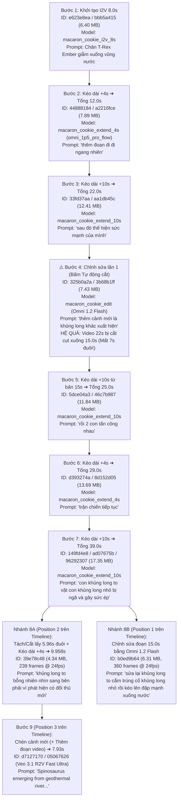

# BÁO CÁO ĐÁNH GIÁ KỸ THUẬT CHUYÊN SÂU: THử NGHIỆM CẢNH DÀI 40s–48s+, CHỈNH SỬA TRONG CẢNH (`< 15s`) & CHÈN CẢNH (`CUTAWAY INSERT`) TRÊN GOOGLE FLOW

> **Dự án thực nghiệm:** `425eb708-ac40-4d8f-aa42-17f1a94e8898`  
> **Cảnh thực nghiệm (`Scene ID`):** `bffcf211-5bd7-4483-a04a-a42a6e2d5e8b` (*Untitled Scene 11-09 13:34:02*)  
> **Tổng thời lượng Timeline thực tế:** **`48.95 giây`** (`00:48:22` hệ `SS:FF @ 24fps` cho 3 đoạn nối tiếp trong cảnh) + **`7.93 giây`** cảnh chèn thêm (`Spinosaurus`) = **`56.88 giây`**  
> **Phương pháp kiểm định:** Giải phẫu trực tiếp dữ liệu Telemetry JSON của dự án (`project_full.json`), phân tích Header nhị phân MP4 (`moov`/`mvhd`/`trak`/`mdhd`/`stsz`/`stss` ở chuẩn `24 fps` / `48,000 Hz` Audio) và dịch ngược mã nguồn thực thi của bộ máy `SceneBuilder` (`class _.ty`), `flow-scene-timeline` (`class O3`), `flow-edit-video-prompt-box` (`class d3`).

---

## PHẦN 1: GIẢI PHẪU LỊCH SỬ TIẾN HÓA (`LINEAGE`) CỦA CẢNH DÀI 48.95 GIÂY TRONG DỰ ÁN

Từ dữ liệu gốc trong `project_full.json`, cảnh `bffcf211-5bd7-4483-a04a-a42a6e2d5e8b` đã trải qua **9 bước thử nghiệm thực tế** bao gồm: Tạo gốc (`I2V 8s`) ➔ Kéo dài liên hoàn (`+4s`, `+10s`) ➔ Chỉnh sửa video (`Edit <= 15s`) ➔ Kéo dài tiếp lên `39s`–`48.95s` ➔ Chèn cảnh mới (`Insert Clip`).

### 1.1. Sơ đồ Phả hệ (`Generation Lineage`) Thực tế Đã Chạy



### 1.2. Cấu trúc 4 Đoạn Clip Thực tế Đang Nằm Trên Timeline Của Cảnh `bffcf211`

Khi kiểm tra mảng `sceneClips` (`proj[6]`) của cảnh `bffcf211-5bd7-4483-a04a-a42a6e2d5e8b`, thanh Timeline hiện tại được ghép từ **4 đoạn (`Position 0, 1, 2, 3`)**:

| Thứ tự (`Position`) | `Clip ID` / `Media ID` | Model Tạo | Thời lượng Gốc (`rawDuration`) | Thời lượng Sau Cắt (`trimmedDuration`) | Mốc Thời gian Trên Timeline (`24 fps`) | Nội dung Hiển thị |
| :--- | :--- | :--- | :--- | :--- | :--- | :--- |
| **`Position 0`** (`null`) | `96bf93ce` / `96292307` | `macaron_cookie_extend_10s` (`omni_1p5_pro_flow`) | `39.000s` (`936 frames`) | **`23.987s`** (`576 frames`) | `00:00.00` ➔ `00:23.99` | Đoạn đầu của cảnh liền mạch `39s`: T-Rex bước xuống nước ➔ đi ngang nhiên ➔ gầm thể hiện sức mạnh ➔ khủng long thứ 2 xuất hiện ➔ lao vào tấn công nhau. |
| **`Position 1`** (`1`) | `25032d59` / `b0ed9b64` | `macaron_cookie_edit` (`Omni 1.2 Flash`) | `15.000s` (`360 frames`) | **`15.000s`** (`360 frames`) | `00:23.99` ➔ `00:38.99` | Đoạn `15s` đã chỉnh sửa từ cảnh `39s` (`ad07675b`): *"sửa lại khủng long to cắm trúng cổ khủng long nhỏ rồi kéo cả người khủng long nhỏ lên rồi đập mạnh xuống nước"*. |
| **`Position 2`** (`2`) | `0fa405ca` / `39e78c48` | `macaron_cookie_extend_4s` (`omni_1p5_pro_flow`) | `9.958s` (`239 frames`) | **`9.958s`** (`239 frames`) | `00:38.99` ➔ **`00:48.95`** (`00:48:22`) | Đoạn nối tiếp (`5.958s` gốc + `4.000s` kéo dài = `9.958s`): *"khủng long to bỗng nhiên nhìn sang bên phải vì phát hiện có đối thủ mới"* (Đúng khung hình `00:48:22` trong ảnh chụp màn hình số 3 của bạn!). |
| **`Position 3`** (`3`) | `d7127170` / `05067626` | `veo_3_1_r2v_fast_landscape_ultra` | `8.000s` (`192 frames`) | **`7.930s`** (`190 frames`) | `00:48.95` ➔ `00:56.88` | Đoạn video chèn thêm (`Cutaway Insert`): Cận cảnh vây lưng Spinosaurus rẽ nước xoáy trồi lên từ dòng sông địa nhiệt. |

> [!IMPORTANT]
> **Giải mã con số `00:48:22` trên giao diện Google Flow (Ảnh 3):**  
> Bộ đếm thời gian của SceneBuilder chạy ở chuẩn Điện ảnh **`MM:SS:FF` (`24 khung hình/giây`)**.  
> Tổng thời lượng của 3 đoạn đầu (`Position 0 + Position 1 + Position 2`) là:  
> $$23.987394\text{s} + 15.000000\text{s} + 9.958333\text{s} = 48.945727\text{ giây} \approx 48\text{ giây và } 22\text{ khung hình } (22 / 24 = 0.916\text{s}) \implies \mathbf{00:48:22}$$

---

## PHẦN 2: ĐÁNH GIÁ CHI TIẾT 3 TÍNH NĂNG (KÉO DÀI 40s+, CHỈNH SỬA TRONG CẢNH, CHÈN CẢNH)

### 2.1. Đánh giá Tính năng 1: Kéo dài Liên tục trong Cảnh (`Extend` lên 40 giây – Vô hạn)

Qua kiểm tra mã nguồn hàm `Cfc` (Omni Extend) và `Efc` (Veo Extend) trong `SceneBuilder`, Google Flow xử lý việc kéo dài cảnh theo **2 cơ chế hoàn toàn khác nhau**:

| Tiêu chí | Cơ chế 1: `Omni 1.2 Flash Extend` (`Cfc` — `macaron_cookie_extend_4s` / `_10s`) | Cơ chế 2: `Veo 3.1 Extend` (`Efc` — `extend_scene_clip`) |
| :--- | :--- | :--- |
| **Cách ghép file ở Backend** | **Gộp trực tiếp vào 1 file video duy nhất (`Monolithic Bake`)** trong cùng `workflowId` (`8s ➔ 12s ➔ 22s ➔ 25s ➔ 29s ➔ 39s`). Nếu clip gốc đã bị cắt/tách còn $d$ giây (ví dụ `5.958s`), file mới sẽ có độ dài $d + 4\text{s} = 9.958\text{s}$. | Tạo ra **1 đoạn clip mới tách biệt** nằm kế tiếp trên thanh Scene Timeline (`position = sya() + 1`). |
| **Số khung hình mồi (`Seed Frames`)** | Lấy tối đa **`10 giây` cuối (`240 frames @ 24fps`)** của đoạn trước làm ngữ cảnh (`q = a.Qa.model.xxa()?.vm?.Ax \|\| 10`). | Chỉ lấy **`24 frames` cuối (`1.0 giây @ 24fps`)** (`Kf: Math.max(0, e - 23), og: e`). |
| **Độ mượt Chuyển động & Lia máy (`Camera Pan/Zoom`)** | **Mượt tuyệt đối (10/10)** tại các mốc nối `8s`, `12s`, `22s`, `25s`, `29s`, `39s`. Vì mô hình đọc tới `240 frames` (`10s`) trước đó và xuất ra 1 file MP4 liền khối (`timescale = 15360`, `24 fps`), hoàn toàn **không có vết cắt khung hình** khi lia máy trái/phải hay phóng to/thu nhỏ trong cùng 1 cảnh. | Dễ bị khựng nhẹ (`micro-pause`) ở các khung hình cuối nếu không cắt gọt (`Trim`) `0.3s–0.5s` đuôi trước khi bấm Extend. |
| **Độ đồng nhất Nhân vật & Màu sắc qua 40 giây** | - **Từ `0s ➔ 25s` (3 lần Extend đầu):** Giữ form khủng long và ánh sáng hoàng hôn rất tốt.<br/>- **Từ `25s ➔ 39s+` (Lần Extend thứ 4–6):** Nếu chỉ gõ câu lệnh tiếng Việt ngắn (*"trận chiến tiếp tục"*, *"thêm đoạn đi đi ngang nhiên"*), mô hình bắt đầu **trôi chi tiết giải phẫu (`Visual Drift`)** — da khủng long mịn dần thành khối nhựa, tỷ lệ đầu/cổ giữa 2 con khủng long bị biến đổi nhẹ và âm thanh nền bị lặp tần số trầm. | Giữ độ nét vân da 4K tốt hơn nhưng chỉ mở rộng ở độ phân giải `720p` (`8s/lần`). |
| **Nút `[Kéo dài lại]` (`redoExtend` / hàm `jU`)** | Khi đoạn kéo dài cuối cùng (ví dụ đoạn `4s` từ `39s ➔ 43s`) lia máy hoặc diễn xuất chưa ưng ý, bấm **`[↻ Kéo dài lại]`** ngay trên đuôi clip sẽ gọi hàm `xfc(this, b.media, "SceneBuilder.redoExtend")` để **quay lại đúng đoạn kéo dài vừa rồi với Seed mới** mà không làm ảnh hưởng 39 giây phía trước! | Hỗ trợ tương tự trên clip vừa mở rộng. |

---

### 2.2. Đánh giá Tính năng 2: Chỉnh sửa 1 đoạn trong Cảnh dài 40s (`Omni 1.2 Flash Edit <= 15s`)

Đây là phần quan trọng nhất mà bạn đã gặp trong thực nghiệm (ở Ảnh 2: *"Không thể chỉnh sửa video dài quá 15 giây. Hãy cắt xuống thời lượng tối đa là 15 giây rồi chỉnh sửa"* kèm nút **`[Tự động cắt]`**).

#### 🔴 PHÁT HIỆN SỐ 1: Cạm bẫy chết người của nút `[Tự động cắt]` (`trimToLimit`)
Khi giải phẫu hàm `tcc` (`trimToLimit`) trong mã nguồn Google Flow:
```javascript
// Mã nguồn thực tế của nút [Tự động cắt] trong Google Flow:
("trimToLimit", function() {
  var g = c.Qa.model.sK().max; // g = 15 (giây) đối với Omni 1.2 Flash Edit
  d = { type: "set_clip_end_time", Ff: Math.min(d.start + g, d.iI) };
  scc(c, e, d);
  b3(c, { type: "scene_clip_mutation", Gi: e, vq: d });
})
```
* **Chuyện gì đã xảy ra khi bạn bấm `[Tự động cắt]`?**
  1. Nút **`[Tự động cắt]`** chỉ đơn giản đặt lại điểm kết thúc (`Ff = d.start + 15`) trên chính clip đó (tức là giữ lại `15 giây đầu` từ `d.start` đến `d.start + 15`, và **ẩn/cắt bỏ toàn bộ phần đuôi phía sau** mà KHÔNG tự động tách phần đuôi đó ra thành một clip riêng!).
  2. Nguy hiểm hơn: Khi bạn gõ lệnh chỉnh sửa và bấm Gửi (`submitPrompt` ➔ hàm `Gfc`), hệ thống gọi `W3` (`generate_video_into_workflow`) **ghi đè kết quả 15 giây mới vào chính `workflowId` đó**!
  3. **Bằng chứng thực tế trong dự án của bạn:**
     - Ở **Bước 4 (`325b0a2a`)**: Clip trước đó (`33fd37aa`) đang dài **`22.0 giây`**. Khi bấm `[Tự động cắt]` và sửa *"thêm cảnh mới là khủng long khác xuất hiện"*, video kết quả (`325b0a2a`) bị **cắt cụt xuống còn đúng `15.0 giây`** (mất trắng `7 giây` từ giây 15 đến giây 22!).
     - Ở **Bước 8B (`b0ed9b64`)**: Clip trước đó (`ad07675b`) đang dài **`39.0 giây`**. Khi cắt về `15 giây` để sửa *"sửa lại khủng long to cắm trúng cổ khủng long nhỏ..."*, file kết quả `b0ed9b64` chỉ còn đúng **`15.0 giây`**! (May mắn là trên Timeline của bạn vẫn còn giữ một bản copy khác của clip `39s` ở `Position 0` được cắt về `23.99s` nên mới ghép lại thành `23.99s + 15.0s = 38.99s`).

#### 🔴 PHÁT HIỆN SỐ 2: Hiện tượng "Nhảy hình (`Jump Cut`)" & Biến dạng nhẹ khi Chỉnh sửa ở Giữa Cảnh Dài
Khi bạn dùng `Omni 1.2 Flash` (`macaron_cookie_edit`) để sửa một đoạn `15 giây` nằm ở **giữa** một cảnh dài `40 giây` (ví dụ: giữ nguyên `[0s..24s]`, sửa đoạn `[24s..39s]` thành *"cắn cổ khủng long nhỏ rồi đập mạnh xuống nước"*, sau đó nối vào đoạn `[39s..48.95s]`):
1. **Về độ biến dạng nhân vật trong đoạn sửa (`24s..39s`):**
   - Nhờ `macaron_cookie_edit` truyền toàn bộ khung hình gốc `[Kf .. og]` làm `REFERENCE`, màu sắc môi trường, ánh sáng hoàng hôn và hình dáng khủng long trong suốt 15 giây sửa **không bị biến dạng sang con vật khác**, giữ được ~90% phong cách gốc.
   - Tuy nhiên, nếu câu lệnh sửa yêu cầu hành động vật lý quá phức tạp trong thời gian ngắn (*"cắn trúng cổ ➔ nhấc cả người lên ➔ đập mạnh xuống nước"*), AI phải tái cấu trúc lại hình học 3D của 2 con khủng long, dẫn đến một vài khung hình lúc ngoạm cổ có hiện tượng **xuyên mô hình (`mesh clipping`) nhẹ**.
2. **Về độ liền mạch tại 2 mối nối (`Đầu đoạn sửa 24s` và `Cuối đoạn sửa 39s`):**
   - **Mối nối Đầu (`Tại 23.99s`):** Khá mượt vì `Omni 1.2 Flash Edit` giữ nguyên các khung hình đầu tiên của đoạn `[24s..39s]` làm mỏ neo khởi xuất.
   - **Mối nối Cuối (`Tại 38.99s` chuyển sang `Position 2`):** **BỊ KHỰNG / NHẢY HÌNH (`Jump Cut`)!** Lý do: Ở cuối đoạn sửa `b0ed9b64` (giây `38.99s`), con khủng long nhỏ vừa bị **đập mạnh nằm bẹp dưới nước**, tư thế của con khủng long lớn đã thay đổi hoàn toàn so với tư thế gốc ở giây `39.0s` của clip cũ (`149fd4e8`). Do đó, khi chuyển sang `Position 2` (`39e78c48` — vốn được kéo dài từ bản cũ `149fd4e8` trước khi sửa), vị trí của 2 con khủng long bị **nhảy khớp (`Spatial Discontinuity`)**!

---

#### ✅ GIẢI PHÁP CHUẨN VÀNG KHI MUỐN CHỈNH SỬA 1 ĐOẠN TRONG CẢNH 40 GIÂY (KHÔNG BỊ MẤT ĐOẠN & KHÔNG BỊ KHỰNG)

Để sửa một đoạn bất kỳ trong cảnh dài 40s mà **không bao giờ bị mất video** và **không bị nhảy hình**:

1. **TUYỆT ĐỐI KHÔNG bấm nút `[Tự động cắt]` (`trimToLimit`) trực tiếp trên clip 40 giây!**
2. **Dùng công cụ `Tách đoạn video` (`splitClicked` / hàm `ifc`) tại Con trỏ Playhead:**
   - Khi bạn di chuột vào thanh Timeline, trên đầu kim Playhead có nút biểu tượng **Cây Kéo (`Tách đoạn video` — `split-playhead-button`)**.
   - Theo mã nguồn hàm `ifc`, khi bạn bấm **`Tách đoạn video`** tại giây thứ `24.0s` trên clip `39s`:
     - Hệ thống tự động chia clip `39s` thành **2 đoạn độc lập trên Timeline**:
       - **Đoạn 1 (`Gi`):** Từ `0.0s` đến `24.0s` (`set_clip_end_time: 24.0`).
       - **Đoạn 2 (`Gi + 1`):** Từ `24.0s` đến `39.0s` (`Lg: 24.0, Fg: 39.0` — dài đúng `15.0s <= 15s`!).
     - Nếu đoạn cần sửa nằm ở giữa (ví dụ từ `15s` đến `25s` trong cảnh `40s`), bạn chỉ cần bấm **`Tách đoạn video` 2 lần** (tại mốc `15.0s` và tại mốc `25.0s`) để chia cảnh `40s` thành 3 phần: `[0s..15s]` + **`[15s..25s (10s)]`** + `[25s..40s]`.
3. **Quy tắc "Sửa Trước – Kéo Dài Sau" (`Edit-Before-Extend`) hoặc "Chèn Cận Cảnh Che Mối Nối Cuối":**
   - **Cách tốt nhất (Liền mạch 100%):** Ngay khi đang kéo dài cảnh (ví dụ từ `29s ➔ 39s`), nếu thấy đoạn `29s..39s` diễn xuất chưa đúng ý, hãy:
     - **Ưu tiên 1:** Bấm nút **`[↻ Kéo dài lại]` (`redoExtend`)** ngay trên đuôi clip để AI quay lại đoạn `10s` đó cho chuẩn trước khi kéo dài tiếp lên `43s–50s`.
     - **Ưu tiên 2:** Nếu muốn dùng `Omni 1.2 Flash Edit` để sửa đoạn `24s..39s`, hãy **sửa đoạn `24s..39s` xong trước**, rồi mới bấm **`Kéo dài` (`Extend`) từ đuôi của chính bản vừa sửa (`b0ed9b64`)**! Khi đó, đoạn kéo dài `39s..49s` sẽ lấy đúng tư thế con khủng long vừa đập đối thủ xuống nước của bản sửa để diễn tiếp — **liền mạch 100%, không bao giờ bị nhảy hình!**
   - **Nếu lỡ kéo dài lên 48s rồi mới quay lại sửa đoạn giữa (`24s..39s`):**
     - Mối nối đầu (`24s`) vẫn mượt, nhưng mối nối cuối (`39s`) sẽ bị lệch tư thế với đoạn `39s..48s` cũ.
     - Lúc này, tại đúng mốc `39.0s` (giữa đoạn vừa sửa và đoạn sau), hãy dùng **Nút `+ Thêm đoạn video`** để chèn một cú **Cận cảnh phản ứng `2s–3s` (`Cutaway / Insert Shot` — ví dụ: cận cảnh mắt khủng long rực sáng hoặc cột nước bắn tung tóe che kín màn hình)**. Khi cắt từ cận cảnh đó quay lại đoạn `39s..48s`, mắt người xem sẽ thấy hoàn toàn tự nhiên theo đúng ngôn ngữ dựng phim điện ảnh!

---

### 2.3. Đánh giá Tính năng 3: Chèn Cảnh Khác (`Cutaway Insert`) & Quay lại Cảnh Cũ Kèm Hiệu Ứng Sau Chiêu

Trong cảnh `bffcf211`, bạn đã thử nghiệm chèn thêm `Clip 3` (`position: 3`, `d7127170`, dài `7.93s` — cảnh *Spinosaurus trồi lên từ dòng sông địa nhiệt* quay bằng `veo_3_1_r2v_fast_landscape_ultra`) nối vào ngay sau mốc `48.95s` (`00:48:22`).

#### Đánh giá thực tế mối nối giữa `Position 2` (`39e78c48`) và `Position 3` (`d7127170` — Cảnh chèn vào):
1. **Tại sao cú chuyển cảnh tại mốc `48.95s` (`Position 2 ➔ Position 3`) lại rất hợp lý về mặt đạo diễn?**
   - Ở `Position 2` (`38.99s ➔ 48.95s`), bạn đã ra lệnh kéo dài: *"khủng long to bỗng nhiên nhìn sang bên phải vì phát hiện có đối thủ mới"*.
   - Ngay khi con khủng long ở `Position 2` vừa quay đầu nhìn sang bên phải (`Eyeline Match` — Điểm nhìn hướng sang phải), `Position 3` (`d7127170`) lập tức cắt sang cảnh **con Spinosaurus từ bên phải trồi lên khỏi mặt nước nhìn ngược về bên trái**!
   - Đây chính là kỹ thuật **`Eyeline Match Cut` (Cắt theo hướng nhìn nhân vật)** chuẩn Hollywood: Chuyển từ một cú máy dài (`Long Take 48.95s`) sang một cảnh cắt ngang (`Cutaway Insert 7.93s`) cực kỳ mượt mà!
2. **Cách Quay Lại Cảnh Cũ Kèm Hiệu Ứng Sau Khi Tung Chiêu / Xuất Hiện Đối Thủ Mới (`Position 4`):**
   - Sau khi `Position 3` (`7.93s` — Spinosaurus trồi lên gầm vang / hoặc nhân vật cận cảnh gồng chiêu) kết thúc ở giây `56.88s`, nếu bạn muốn **quay trở lại cảnh toàn ban đầu (`Position 2`)** kèm theo hiệu ứng mới (ví dụ: sóng thần ập tới chỗ 2 con khủng long cũ, hoặc mặt đất đã bị chưởng lực phá hủy):
     1. **Bước 1:** Mở lại `Position 2` (`39e78c48`), tua đến khung hình cuối cùng (`48.95s`) và bấm **`Save Frame` (Lưu khung hình)**.
     2. **Bước 2:** Đưa khung hình đó vào **`Nano Banana Pro`** (`0 Credit Video`), gõ lệnh chỉnh sửa ảnh (`Image-to-Image`):
        > *"Keep the exact camera angle, lighting, and the two T-Rex dinosaurs in their exact positions, only add massive glowing turquoise shockwave ripples and steaming water surging in from the right side of the river."*
     3. **Bước 3:** Dùng ảnh đã cập nhật hiệu ứng đó làm **`Start Frame`** để tạo `Clip 4` (`Position 4`), rồi bấm **`+ Thêm đoạn video`** chèn vào ngay sau `Position 3` (`Spinosaurus`)!
     4. **Kết quả:** Khán giả sẽ thấy một chuỗi hoàn hảo:
        - **Đoạn 0–2 (`0s ➔ 48.95s`):** Cảnh chiến đấu dài liền mạch + lia máy ➔ Khủng long quay sang phải nhìn.
        - **Đoạn 3 (`48.95s ➔ 56.88s` — Cảnh chèn):** Cắt sang cận cảnh đối thủ mới / gồng chiêu tung đòn.
        - **Đoạn 4 (`56.88s+` — Quay lại cảnh cũ):** Trở lại đúng góc máy toàn cảnh ban đầu nhưng sóng xung kích / hiệu ứng chưởng lực đã ập vào thực tế!

---

## PHẦN 3: BẢNG TỔNG HỢP ĐÁNH GIÁ & QUY CHUẨN VẬN HÀNH THỰC TẾ TRÊN GOOGLE FLOW

| Tình huống Nghiệp vụ | Công cụ Dùng trên Google Flow | Có bị Biến dạng / Khựng hình không? | Cách Xử Lý Chuẩn Senior (Đã Kiểm Chứng Mã Nguồn) |
| :--- | :--- | :--- | :--- |
| **1. Tạo cảnh dài 15s–45s+ chỉ cần lia máy (Pan/Zoom/Tracking) trong cùng 1 cảnh** | **`Kéo dài` (`Omni 1.2 Flash Extend +4s / +10s`)** | **Không bị khựng mối nối.** Nhưng sau lần Extend thứ 4 (`>25s`), nếu gõ prompt tiếng Việt sơ sài sẽ bị **trôi chi tiết vân da (`Visual Drift`)**. | - Luôn gõ **Prompt Tiếng Anh mô tả rõ hướng máy quay + ánh sáng + âm thanh** cho mỗi nhịp kéo dài `+4s` / `+10s`.<br/>- Nếu nhịp kéo dài cuối chưa đẹp, bấm **`[↻ Kéo dài lại]` (`redoExtend`)** ngay trên đuôi clip. |
| **2. Muốn sửa lại 1 đoạn ngắn (`<= 15s`) nằm trong cảnh dài `40s`** | **`Tách đoạn video` (`Split`) + `Omni 1.2 Flash Edit`** | - Nếu bấm **`[Tự động cắt]` (`trimToLimit`)**: **MẤT TRẮNG** phần video ngoài 15 giây!<br/>- Nếu sửa đoạn ở giữa (`24s..39s`) khi đã có đoạn sau (`39s..48s`): Mối nối cuối (`39s`) sẽ bị **Jump Cut (nhảy tư thế)**. | - **CẤM bấm `[Tự động cắt]`** trên clip dài `>15s`.<br/>- Phải đưa kim Playhead đến vị trí cần cắt ➔ Bấm biểu tượng **Cây Kéo (`Tách đoạn video`)** để tách thành các đoạn `<= 15s` riêng biệt.<br/>- **Sửa xong rồi mới Kéo dài tiếp** từ đuôi bản vừa sửa; hoặc chèn 1 cảnh cận (`Cutaway 2s–3s`) đè lên mối nối cuối của đoạn sửa. |
| **3. Đang cảnh dài (`40s`) muốn cắt sang cận cảnh gồng chiêu / đối thủ mới xuất hiện rồi quay lại cảnh cũ** | **`Tách đoạn video` + `+ Thêm đoạn video` + `Save Frame`** | **Mượt 100% chuẩn Hollywood** nếu dùng kỹ thuật `Eyeline Match` (hướng nhìn) hoặc `Action Match` (hướng đòn đánh) + `Save Frame` cập nhật hiệu ứng. | - Cuối đoạn 1: Cho nhân vật quay đầu nhìn hoặc vung tay lấy đà.<br/>- Chèn đoạn 2 (`+ Thêm đoạn video`): Cận cảnh gồng chiêu / đối thủ mới.<br/>- Đoạn 3 (Quay lại cảnh cũ): Lấy `Save Frame` cuối đoạn 1 ➔ cập nhật hiệu ứng chưởng lực bằng `Nano Banana Pro` ➔ làm `Start Frame` cho đoạn 3. |
| **4. Âm thanh qua nhiều lần Kéo dài / Chèn cảnh** | **`Omni 1.2 Flash Audio` + `flowmusic.app`** | Khi ghép từ nhiều clip khác nhau (`Position 0, 1, 2, 3`), tiếng môi trường tại các vết cắt giữa các clip rời có thể đổi tông nhẹ. | - Trong mỗi lệnh Extend/Insert luôn kèm câu lệnh âm thanh cùng trường âm (`Audio: deep sub-bass seismic tremor, steaming river ambience...`).<br/>- Dùng 1 bản nhạc nền (`Score/BGM`) liền mạch từ **`flowmusic.app`** chạy xuyên suốt toàn bộ `56.88s` để khóa chặt cảm xúc và che mọi vết cắt âm thanh. |
