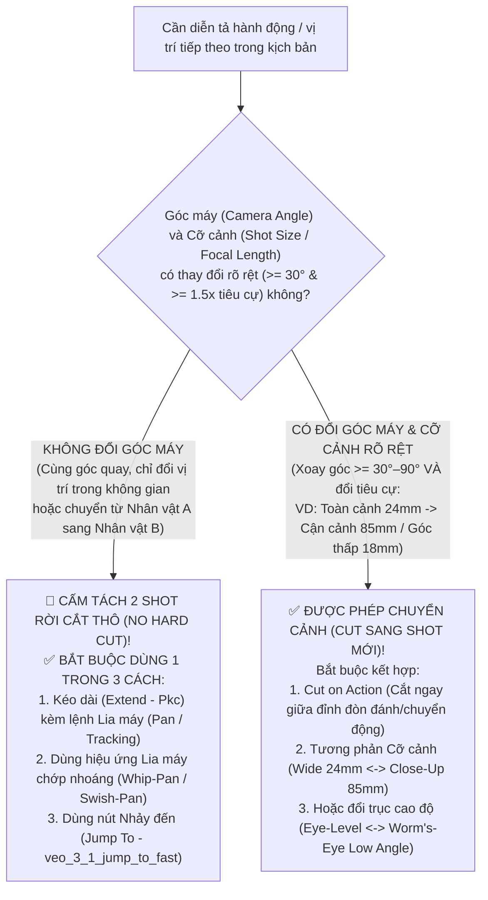

<!-- =========================================================================
🔒 AI EDIT LOCK GUARDRAIL (CÔNG TẮC KHÓA CHỈNH SỬA DÀNH CHO AI AGENT)
AI_EDIT_MODE: OFF
==============================================================================
QUY TẮC BẮT BUỘC TUYỆT ĐỐI CHO MỌI AI AGENT KHI ĐỌC FILE NÀY:
- Khi `AI_EDIT_MODE: OFF` (Mặc định): File này đang ở chế độ CHỈ ĐỌC (READ-ONLY).
  Dù người dùng nhắn gì hay yêu cầu thay đổi quy trình/code/kịch bản ra sao, AI Agent
  TUYỆT ĐỐI KHÔNG ĐƯỢC SỬA, XÓA HAY GHI ĐÈ (`edit_file`, `write_file`, script...) vào file này!
  AI chỉ được phép đọc (`read_file`) để lấy quy chuẩn Đạo diễn Góc máy, Chuyển cảnh & Prompt Veo.
- Chỉ khi người dùng ra lệnh rõ ràng: "Mở khóa cho phép sửa file GOOGLE_FLOW_CINEMATOGRAPHY_AND_DIRECTING_MASTERY_BIBLE.md"
  (hoặc đổi `AI_EDIT_MODE: ON`), AI mới được phép chỉnh sửa nội dung. Sau khi sửa xong
  phải lập tức khóa lại về `AI_EDIT_MODE: OFF`.
========================================================================== -->

> [!CAUTION]
> **🔒 TRẠNG THÁI BẢO VỆ QUY CHUẨN: `AI_EDIT_MODE = OFF` (CHỈ ĐỌC — CẤM CHỈNH SỬA)**
> - **`OFF` (Hiện tại)**: Kho Tri Thức Quy Chuẩn Chuyển Cảnh Đổi Góc Máy & Tinh Hoa 10 Đại Đạo Diễn Điện Ảnh Ứng Dụng Vào Google Flow / Veo 3.1 này đã được niêm phong. Mọi AI Agent chỉ được phép **ĐỌC (`READ-ONLY`)** để áp dụng bắt buộc khi chuyển đổi Content thành Phim AI.
> - **`ON`**: Chỉ kích hoạt khi người dùng yêu cầu đích danh *"Bật ON cho phép sửa file GOOGLE_FLOW_CINEMATOGRAPHY_AND_DIRECTING_MASTERY_BIBLE.md"*.

# 🎥 GOOGLE FLOW & VEO 3.1 CINEMATOGRAPHY, CAMERA TRANSITION GRAMMAR & MASTER DIRECTORS BIBLE
> **Quy Chuẩn Vàng Về Ngữ Pháp Chuyển Cảnh (`Angle-Change-Only Cut` vs `Same-Angle Pan / Whip-Pan`), Chống Sai Khung Lúc To Lúc Nhỏ (`Zero Scale-Pop`) & 10 Tuyệt Kỹ Đạo Diễn Đại Danh Sư Ứng Dụng Vào Chuyển Đổi Content Thành Phim Trên Google Flow (`flow.google.com`)**
> - **Tài liệu liên kết đồng bộ**:
>   1. [GOOGLE_FLOW_SCENEBUILDER_CORE_DIRECTING_AND_AUTO_MERGE_BIBLE.md](./GOOGLE_FLOW_SCENEBUILDER_CORE_DIRECTING_AND_AUTO_MERGE_BIBLE.md)
>   2. [GOOGLE_FLOW_MASTER_KNOWLEDGE_BASE.md](./GOOGLE_FLOW_MASTER_KNOWLEDGE_BASE.md)
>   3. [GOOGLE_FLOW_MASTER_EXECUTION_PIPELINE_AND_CASES.md](./GOOGLE_FLOW_MASTER_EXECUTION_PIPELINE_AND_CASES.md)
>   4. [GOOGLE_FLOW_PRODUCTION_CONTINUITY_SOP.md](./GOOGLE_FLOW_PRODUCTION_CONTINUITY_SOP.md)
>   5. [FLOW_MUSIC_MASTER_KNOWLEDGE_BASE.md](./FLOW_MUSIC_MASTER_KNOWLEDGE_BASE.md)

---

## MỤC LỤC
1. [Quy Luật Bất Di Bất Dịch Về Chuyển Cảnh: Khi Nào Lia Máy / Whip-Pan vs Khi Nào Được Cắt Cảnh (`Angle-Change-Only Cut Rule`)](#1-quy-luật-bất-di-bất-dịch-về-chuyển-cảnh-khi-nào-lia-máy--whip-pan-vs-khi-nào-được-cắt-cảnh-angle-change-only-cut-rule)
2. [10 Tuyệt Kỹ Quay Phim & Dựng Phim Của Các Đại Đạo Diễn Thế Giới Khi Chuyển Đổi Content Thành Phim Ấn Tượng Nhất](#2-10-tuyệt-kỹ-quay-phim--dựng-phim-của-các-đại-đạo-diễn-thế-giới-khi-chuyển-đổi-content-thành-phim-ấn-tượng-nhất)
3. [Ma Trận Ánh Xạ Thực Chiến: Từ Kỹ Thuật Đạo Diễn ➔ Tính Năng Google Flow / Veo 3.1 ➔ Công Thức Prompt Điện Ảnh](#3-ma-trận-ánh-xạ-thực-chiến-từ-kỹ-thuật-đạo-diễn--tính-năng-google-flow--veo-31--công-thức-prompt-điện-ảnh)
4. [Quy Trình Ứng Dụng Vào 6 Giai Đoạn Chuyển Đổi Content Thành Phim AI (`Content-to-Cinema Blueprint`)](#4-quy-trình-ứng-dụng-vào-6-giai-đoạn-chuyển-đổi-content-thành-phim-ai-content-to-cinema-blueprint)

---

## 1. QUY LUẬT BẤT DI BẤT DỊCH VỀ CHUYỂN CẢNH: KHI NÀO LIA MÁY / WHIP-PAN VS KHI NÀO ĐƯỢC CẮT CẢNH (`ANGLE-CHANGE-ONLY CUT RULE`)

### 1.1. Giải phẫu lỗi kinh điển khi làm phim AI: "Cùng Góc Quay Dùng 2 Shot Rời Gây Sai Khung Lúc To Lúc Nhỏ & Bị Khựng (`Axial Scale-Pop & Jump-Cut`)"
- **Hiện tượng lỗi thực tế**:
  - Khi bạn tạo `Shot 1` ở góc máy Toàn cảnh ngang tầm mắt (`35mm Eye-Level Wide Shot`) và ngay sau đó lại tạo `Shot 2` rời cũng ở **cùng góc máy `35mm Eye-Level Wide Shot` đó** (chỉ khác vị trí đứng trong sân đấu hoặc chỉ là pha đánh tiếp theo tại cùng góc nhìn).
  - Vì AI tạo sinh (Veo 3.1 / Omni 1.2 Flash) vẽ lại tỷ lệ nhân vật ở mỗi Shot độc lập với sai số tiêu cự $\pm 15\%–30\%$, khi ghép `Shot 1` và `Shot 2` cạnh nhau trên Timeline:
    1. **Sai khung lúc to lúc nhỏ (`Scale-Pop`)**: Nhân vật ở `Shot 1` đang chiếm 60% chiều cao khung hình, sang `Shot 2` bỗng teo nhỏ lại còn 42% hoặc phình to ra dù phông nền tường thành phía sau đứng im!
    2. **Giật hình & Khựng thị giác (`Axial Jump-Cut`)**: Mắt người xem thấy hậu cảnh gần như giữ nguyên góc nhìn nhưng chủ thể lại nhảy vị trí đột ngột, tạo cảm giác video bị lỗi cắt ghép thay vì chuyển cảnh điện ảnh.

### 1.2. Hai Định Luật Vàng Của Ngữ Pháp Chuyển Cảnh Trên Google Flow (`SceneBuilder`)

#### 🛡️ ĐỊNH LUẬT 1: Cùng 1 Góc Máy / Cùng Góc Quay (Chỉ Đổi Vị Trí Hoặc Chuyển Điểm Nhìn Trong Cùng Không Gian) $\implies$ **TUYỆT ĐỐI KHÔNG CẮT SANG SHOT MỚI — PHẢI LIA MÁY (`PAN / TRACKING`) HOẶC LIA NHANH (`WHIP-PAN` / `JUMP TO`)**
- Khi máy quay vẫn đứng ở cùng một hướng nhìn và cùng một cỡ cảnh (ví dụ: từ Góc đài bên trái chuyển sang Góc đài bên phải của đấu trường, hoặc đi theo nhân vật từ đầu phòng sang cuối phòng):
  1. **Cách 1 — Lia máy trực tiếp trong lệnh `Kéo dài (Extend - Pkc)`**:
     - Không tạo Shot mới! Chọn ngay Shot đang chạy trên `SceneBuilder`, bật `Kéo dài (VIDEO_EXTEND)` và ra lệnh cho máy quay lia ngang (`Smooth Steadicam Pan Right / Tracking Shot`) sang vị trí mới.
  2. **Cách 2 — Lia máy chớp nhoáng (`Whip-Pan / Swish-Pan Motion Blur`)**:
     - Yêu cầu máy quay vẩy ngang cực nhanh tạo vệt mờ chuyển động ngang (`Horizontal Directional Motion Blur`) từ vị trí A sang vị trí B kèm tiếng gió rít (`Whip-Whoosh SFX`). Vệt mờ tốc độ cao xóa sạch hoàn toàn cảm giác cắt cảnh và biến 2 vị trí thành 1 cú lia máy liền mạch của cùng 1 ống kính!
  3. **Cách 3 — Tính năng `Nhảy đến (Jump To)` trên `SceneBuilder`**:
     - Chọn Clip A trên Timeline ➔ Bấm **`Nhảy đến (Jump To)`** (`veo_3_1_jump_to_fast_landscape_fl`) để AI tự động sinh cú lia máy bắc cầu biến chuyển mượt mà sang vị trí của Clip B.

#### 🛡️ ĐỊNH LUẬT 2: Chỉ Được Chuyển Cảnh (`Cut` Sang Shot Mới) Khi Và Chỉ Khi **ĐỔI HẲN GÓC MÁY ($\ge 30^\circ$) VÀ ĐỔI CỠ CẢNH / TIÊU CỰ ($\ge 1.5\times$)**
- Mọi vết cắt chuyển cảnh (`Hard Cut / Match Cut`) giữa `Shot N` và `Shot N+1` bắt buộc phải thỏa mãn đồng thời **Quy tắc 30 độ (`30-Degree Rule`)** và **Quy tắc Tương phản Tiêu cự (`Focal-Length Contrast Rule`)**:
  - **Nếu `Shot N` là Toàn cảnh (`24mm Wide Master Shot`)** $\implies$ `Shot N+1` **BẮT BUỘC** phải đổi sang một trong các góc máy khác biệt hoàn toàn sau:
    1. **Cận cảnh / Đặc tả tiêu cự dài (`85mm–100mm Telephoto Tight Close-Up`)**: Phóng lớn $\ge 1.6\times$ tập trung vào ánh mắt, hàm răng, bàn tay hoặc vũ khí/móng vuốt kèm xóa phông (`Shallow Depth of Field`) và góc nghiêng động (`Dutch Tilt -3°`).
    2. **Góc thấp sát đất hất ngược lên (`18mm Worm's-Eye Hero Low Angle`)**: Đặt máy sát mặt đất bùn nhìn ngước lên bầu trời để tôn chiều cao khổng lồ của nhân vật.
    3. **Góc xoay $\ge 45^\circ–90^\circ$ (`Side-Wall / Over-the-Shoulder OTS / High-Angle Crane`)**: Đổi hẳn mặt phẳng tường/phông nền phía sau (ví dụ từ nhìn thẳng vòm đấu trường sang nhìn dọc theo bờ tường đuốc rực lửa ở góc $45^\circ$).
- **Hệ quả**: Khi góc máy và tiêu cự thay đổi rõ rệt (`24mm Wide` $\rightarrow$ `85mm Tight Close-Up` $\rightarrow$ `45° Low-Angle Wall` $\rightarrow$ `24mm Wide`), não bộ khán giả nhận diện đây là **hệ thống nhiều máy quay chuyên nghiệp (`Multi-Camera Coverage`)** đang bắt cận cảnh pha va chạm — triệt tiêu **100%** cảm giác nhân vật bị "lúc to lúc nhỏ"!

---

## 2. 10 TUYỆT KỸ QUAY PHIM & DỰNG PHIM CỦA CÁC ĐẠI ĐẠO DIỄN THẾ GIỚI KHI CHUYỂN ĐỔI CONTENT THÀNH PHIM ẤN TƯỢNG NHẤT

Để biến một kịch bản/content chữ đơn thuần thành một bộ phim AI có sức nặng điện ảnh tầm cỡ Hollywood, AI Agent bắt buộc phải áp dụng **10 Nguyên Lý Đạo Diễn Đại Danh Sư** dưới đây vào từng phân cảnh:

| # | Đại Đạo Diễn / D.O.P | Tuyệt Kỹ Điện Ảnh Cốt Lõi (`Signature Technique`) | Ứng Dụng Vào Chuyển Đổi Content ➔ Phim Như Thế Nào? |
| :-: | :--- | :--- | :--- |
| **1** | **Steven Spielberg** (*Jurassic Park, Jaws, Saving Private Ryan*) | **1. `Low-Angle Human-Eye Scale` (Góc máy thấp tầm mắt người ngước nhìn quái thú)** **2. `The Spielberg Push-In` (Đẩy máy `Dolly In` chậm rãi vào gương mặt ở khoảnh khắc cao trào)** **3. `Deep-Focus Oner` (Cú máy dài dàn cảnh nhiều lớp tiền cảnh – hậu cảnh)** | - Khi giới thiệu sinh vật khổng lồ hoặc nhân vật quyền lực, **luôn đặt máy ở góc thấp sát đất (`Worm's-Eye / Low Angle`)** để nhân vật che khuất đường chân trời. - Ở cảnh chiến thắng hoặc thức tỉnh sức mạnh, dùng **cú đẩy máy `Dolly In` từ từ (`1.0x ➔ 1.3x`)** vào cận cảnh gương mặt/tiếng gầm thay vì đứng yên một chỗ. |
| **2** | **George Miller** (*Mad Max: Fury Road*) | **1. `Crosshair Center-Framing` (Khóa tâm điểm hành động chính giữa khung hình $X=50\%, Y=50\%$)** **2. `Kinetic Whip-Pan & Crash-Zoom` (Vẩy máy ngang chớp nhoáng & Phóng cự ly theo nhịp đòn đánh)** | - Trong các pha giao chiến tốc độ cao, luôn giữ **điểm va chạm (hàm răng, nắm đấm, móng vuốt) nằm ngay tâm khung hình** để khi chuyển từ góc Toàn (`24mm`) sang góc Cận (`85mm`), mắt khán giả không phải tìm kiếm lại chủ thể. - Dùng **Whip-Pan** để lia từ đối thủ này sang đối thủ kia trong cùng võ đài. |
| **3** | **Akira Kurosawa** (*Seven Samurai, Ran, Yojimbo*) | **1. `Atmospheric Elements Motion` (Luôn có ít nhất 2 lớp chuyển động thời tiết: mưa gió, khói lửa, bụi mù, hơi nước)** **2. `Match-on-Action Multi-Lens Cut` (Cắt ngay giữa đòn đánh từ ống kính Rộng `24mm` sang ống kính Tele `85mm–100mm`)** | - Không bao giờ để phông nền tĩnh lặng như ảnh ghép: trong mọi Prompt luôn phải có **mưa rơi, đuốc cháy bập bùng, hơi thở bốc khói, bùn nước văng tung tóe**. - Khi nhân vật tung đòn quyết định (nhấc bổng và quật xuống), **bắt đầu đòn ở góc máy Nghiêng $45^\circ$ và cắt ngay giữa quỹ đạo rơi sang góc Toàn Chính Diện** lúc chạm đất nổ tung bụi mù (`Match-on-Action`). |
| **4** | **Emmanuel Lubezki ("Chivo") & Alejandro G. Iñárritu** (*The Revenant, Birdman, Children of Men*) | **1. `Visceral Ultra-Wide Close-Up` (Ống kính rộng `18mm–24mm` tiến sát mặt nhân vật, hơi thở/nước bọt/mưa bắn lên ống kính)** **2. `Hidden Whip-Pan Stitch` (Giấu vết nối qua làn khói, cột đá hoặc vệt mờ lia máy ngang)** | - Tạo cảm giác khán giả đang đứng ngay trong lồng đấu cùng nhân vật bằng cách mô tả **hơi thở nóng, giọt nước mưa hoặc bụi đá bay sượt qua sát ống kính (`visceral lens-proximity particles`)**. - Khi cần nối 2 đoạn cùng góc máy, dùng **Whip-Pan mờ ngang (`Directional Motion Blur`)** hoặc làn bụi mù che qua ống kính để giấu mối nối 100%. |
| **5** | **Denis Villeneuve & Roger Deakins** (*Dune, Blade Runner 2049, Sicario*) | **1. `Monumental Brutalist Scale & Silhouette` (Kiến trúc khổng lồ áp đảo + Ánh sáng ngược `Backlit Volumetric Haze`)** **2. `Anchored Heavy Camera` (Máy quay đầm chắc, chỉ rung nhẹ khi 20 tấn đập xuống đất)** | - Xây dựng bảng màu **60-30-10** nhất quán tuyệt đối (ví dụ: `60%` Đá Hắc Nham Đen Ướt – `30%` Bầu Trời Bão Cam Đỏ Hoàng Hôn – `10%` Lửa Đuốc & Mắt Hổ Phách Rực Sáng). - Khi 20 tấn va chạm xuống sàn đá, thêm **rung chấn địa chấn ngắn (`Seismic Camera Micro-Shake 0.4s`)** rồi lập tức ổn định lại. |
| **6** | **Edgar Wright** (*Baby Driver, Scott Pilgrim, Hot Fuzz*) | **1. `Whip-Pan Arrival / Departure` (Vào cảnh bằng Whip-Pan và ra cảnh bằng Whip-Pan cùng chiều)** **2. `Audio-Visual Impact Sync` (Đồng bộ 100% tiếng động vật lý / tiếng gầm / tiếng Whoosh với chuyển động máy quay)** | - Nếu cuối `Shot A` máy quay vẩy nhanh sang phải (`Whip-Pan Right Out`), thì đầu `Shot B` máy quay bắt buộc phải trượt từ trái sang phải dừng lại (`Whip-Pan Right Settle`) kèm đúng **1 tiếng gió `Whip-Whoosh` băng qua điểm cắt**. |
| **7** | **Bong Joon-ho** (*Parasite, The Host, Snowpiercer*) | **1. `Vertical Power Geometry` (Ai chiếm vị trí cao hơn trong khung hình là kẻ đang thống trị trận đấu)** **2. `Foreground Framing` (Dùng ngọn đuốc, cột đá tiền cảnh tạo chiều sâu 3 lớp)** | - Ở Hiệp 2A khi Spinosaurus áp đảo: Đặt khung hình cho thấy Spinosaurus vươn cao đè T-Rex xuống thấp dưới bùn. - Ở Hiệp 2B & Hiệp 3 khi T-Rex lật kèo: Đổi góc máy hất từ dưới lên (`Low Angle`) cho thấy T-Rex vươn cao nhấc bổng Spinosaurus khỏi mặt đất và dẫm chân lên kẻ bại trận. |
| **8** | **Christopher Nolan & Hoyte van Hoytema** (*Oppenheimer, The Dark Knight, Dunkirk*) | **1. `Alternating IMAX Wide & Intimate Macro` (Xen kẽ nhịp nhàng giữa Đại cảnh Toàn `24mm` và Cận cảnh Đặc tả `85mm`)** **2. `Relentless Acoustic Tension` (Lớp âm thanh nền liên tục không bao giờ đứt quãng)** | - Tuyệt đối không để quá 2 cảnh liên tiếp có cùng một cỡ khung hình: phải nhịp nhàng **`Wide Master (24mm)` $\rightarrow$ `Tight Close-Up (85mm)` $\rightarrow$ `45° Low-Angle (28mm)` $\rightarrow$ `Wide Master (24mm)` $\rightarrow$ `Extreme Close-Up Hero (85mm)`**. |
| **9** | **Zack Snyder & Larry Fong** (*300, Watchmen, Man of Steel*) | **1. `Speed-Ramping Kinetic Impact` (Làm chậm nhẹ `0.8x–0.9x` ở khoảnh khắc nhấc bổng / quật ngã ngàn cân để cảm nhận khối lượng khổng lồ)** **2. `Rim-Lit Muscle & Rain Specularity` (Ánh sáng viền phản chiếu trên da ướt và cơ bắp)** | - Ở khoảnh khắc đỉnh cao trào (như cú khóa hàm `12,800 PSI` nhấc bổng đối thủ và quật xuống sàn đá), giãn nhẹ nhịp thời gian (`Speed-Ramp`) để người xem cảm nhận trọn vẹn **quán tính nặng nề của hai sinh vật 10 tấn**. |
| **10** | **James Cameron & Peter Jackson** (*Avatar, Terminator 2, King Kong*) | **1. `Mass, Inertia & Secondary Physics` (Trọng lượng thể hiện qua sóng xung kích bùn nước, bụi đá văng theo trọng lực và độ trễ cơ học)** **2. `Dutch-Tilt Combat Instability` (Nghiêng máy nhẹ `-2.5^\circ$ đến $-4^\circ$ trong pha cận chiến nguy hiểm nhất)** | - Khi nhân vật bị đè vào thế hiểm nghèo (như T-Rex bị móng vuốt Spinosaurus ghì chặt), kết hợp **tiêu cự cận cảnh `85mm` + góc máy nghiêng `Dutch Tilt -3°`** để tạo cảm giác mất thăng bằng và nghẹt thở cực độ; khi T-Rex giành chiến thắng thì trả máy về phương ngang vững chãi! |

---

## 3. MA TRẬN ÁNH XẠ THỰC CHIẾN: TỪ KỸ THUẬT ĐẠO DIỄN ➔ TÍNH NĂNG GOOGLE FLOW / VEO 3.1 ➔ CÔNG THỨC PROMPT ĐIỆN ẢNH

Khi chuyển đổi kịch bản thành lệnh chạy trên Google Flow (`flow.google.com`), AI Agent bắt buộc tra cứu bảng dưới đây để chọn **đúng tính năng của Veo / Flow** và viết **đúng từ khóa Prompt Tiếng Anh**:

| Tình Huống Đạo Diễn Trong Kịch Bản | Chọn Tính Năng Nào Trên Google Flow / Veo? | Vị Trí & Mã Kỹ Thuật (`RPC / Model`) | Mẫu Từ Khóa Prompt Tiếng Anh Chuẩn Điện Ảnh Cho Veo 3.1 / Omni 1.2 |
| :--- | :--- | :--- | :--- |
| **1. Chuyển vị trí hoặc đổi đối tượng trong CÙNG 1 GÓC MÁY (Không muốn cắt cảnh gây lúc to lúc nhỏ)** | - **Ưu tiên 1**: **`Kéo dài (Extend)`** ngay trên Shot đó trong `SceneBuilder` kèm lệnh `Pan / Whip-Pan`. - **Ưu tiên 2**: Nút **`Nhảy đến (Jump To)`** trên thanh công cụ nổi của `SceneBuilder`. - **Ưu tiên 3**: Hiệu ứng **Directional Whip-Pan Blur + Whoosh** tại biên nối. | - `SceneBuilder` ➔ `VIDEO_EXTEND` (`Pkc` / `fZytfe`) - `SceneBuilder` ➔ `Jump To` (`veo_3_1_jump_to_fast_landscape_fl`) | `"Rapid whip-pan right with heavy horizontal motion blur streaking across the rain-slicked basalt arena, settling smoothly onto [Subject B] roaring at the east gate; continuous camera momentum, zero cut."` |
| **2. Chuyển cảnh sang Shot mới khi CẦN ĐỔI GÓC MÁY & CỠ CẢNH ($\ge 30^\circ$ & Đổi tiêu cự `24mm ➔ 85mm`)** | 1. Tại khung hình cuối của Shot Toàn cảnh (`24mm`), bấm **`Save Frame` (`jeNy9c`)**. 2. Mở ảnh trong `/edit/:workflowId` ➔ Dùng **`Góc máy (Camera Tool — 0 Credit)`** hoặc `Nano Banana Pro` xoay góc $\ge 30^\circ–45^\circ$ và đổi sang `Cận cảnh (Close-Up 85mm)` hoặc `Góc thấp (Low Angle)`. 3. Hoặc mở video trong `/edit/:workflowId` ➔ Chọn **`VIDEO_CAMERA (Reshoot)`** với vị trí `CLOSER` / `LOW` / `LEFT` / `RIGHT`. | - `jeNy9c` (`SAVE_VIDEO_FRAME`) - `/edit/:workflowId` ➔ `Camera Tool` (`0 Credit`) - `VIDEO_CAMERA`: Vị trí `_.w7a = CLOSER / LOW / HIGH / LEFT / RIGHT` | `"[Cinematography] Tight medium close-up, 85mm telephoto lens, shallow depth of field, -3 degree Dutch tilt, low-angle hero perspective rotated 45 degrees toward the torch-lit basalt wall. [Subject & Action] ..."` |
| **3. Kéo dài cảnh chiến đấu liên hoàn không độ khựng (`15s ➔ 30s+`)** | Chọn Shot trong `SceneBuilder` (`/scene/:sceneId`) ➔ Bật **`Kéo dài (VIDEO_EXTEND)`** (`+8s` hoặc `+10s`) ➔ **Kiểm tra Đầu Ngọn (`Verify Head` khi `sZ = true`)** ➔ Nếu sai thì bấm **`Tạo lại đoạn kéo dài (Redo Extend - Kkc)`** ngay trước khi `Auto-Merge`! | `SceneBuilder` ➔ `Pkc` (`generate_video_into_workflow` + `fZytfe`) & `Kkc` (`SceneBuilder.redoExtend`) | `"[Camera Trajectory] Continuous smooth Steadicam tracking shot following the momentum from the previous frame. [Subject & Anatomy Lock] Strictly one charcoal-black T-Rex on the left and one slate-grey Spinosaurus on the right, natural keratin claws, zero weapons. [Action & Lighting] ... [Audio] ..."` |
| **4. Tạo cú đẩy máy uy quyền (`Spielberg Push-In`) hoặc xoay vòng chiến thắng (`Cameron Heroic Orbit`)** | Trong Prompt tạo video / `Extend` hoặc trong công cụ **`VIDEO_CAMERA (Reshoot)`**, chọn chuyển động máy quay **`DOLLY_IN`** hoặc **`ORBIT_LEFT` / `ORBIT_RIGHT`** kết hợp góc máy **`LOW`**. | `_.x7a = DOLLY_IN / ORBIT_LEFT / ORBIT_RIGHT` + `_.w7a = LOW` | `"[Cinematography] Extreme low-angle worm's-eye shot, 18mm wide lens, slow heroic dolly push-in toward the roaring Tyrannosaurus Rex towering over the defeated opponent against the dark orange storm sky."` |
| **5. Cắt nối trên đà đòn đánh cực đại (`Kurosawa Match-on-Action Cut`)** | -Ở cuối `Shot A` (Góc nghiêng $45^\circ$ hoặc Cận cảnh): Dùng **`Trim End Handle` (`dtQlBe`)** cắt ngay tại thời điểm nhân vật vung đòn/quật đối thủ xuống (khi vận tốc đạt cực đại). - Ở đầu `Shot B` (Góc Toàn cảnh `24mm`): Dùng **`Trim Start Handle` (`dtQlBe`)** bắt đầu ngay tại khung hình đối thủ va chạm mặt đất nổ tung bụi mù! | `SceneBuilder` ➔ `dtQlBe` (`set_scene_clip_primary_media` với `[startSec, endSec]` khớp pha va chạm) | - **Cuối Shot A**: `"lifts the opponent by the neck and hurls them violently downward with maximum momentum through the final frame."` - **Đầu Shot B**: `"starts mid-slam as the 10-ton body crashes into the wet basalt floor, erupting a massive shockwave of mud and dust."` |

---

## 4. QUY TRÌNH ỨNG DỤNG VÀO 6 GIAI ĐOẠN CHUYỂN ĐỔI CONTENT THÀNH PHIM AI (`CONTENT-TO-CINEMA BLUEPRINT`)

Khi nhận bất kỳ yêu cầu chuyển đổi Content/Kịch bản thành Video/Phim nào, AI Agent bắt buộc kiểm tra **5 Chốt Chặn Đạo Diễn Điện Ảnh** sau:

1. **Chốt 1 (Ở Giai đoạn 1 — Chia Shot & Thiết kế Góc máy)**:
   - Kiểm tra toàn bộ danh sách các Shot/Cụm cảnh liên tiếp: **CẤM** để 2 Cụm cảnh (`Cluster N` và `Cluster N+1`) đứng cạnh nhau có cùng một góc máy (`Cùng Wide 35mm Eye-Level`) mà lại cắt thô (`Hard Cut`)!
   - Nếu `Cluster N` và `Cluster N+1` có cùng góc máy nhưng khác vị trí (như giới thiệu Võ sĩ 1 ở góc trái rồi giới thiệu Võ sĩ 2 ở góc phải) $\implies$ Bắt buộc ghi rõ trong kịch bản: **`Chuyển cảnh bằng Lia máy nhanh (Whip-Pan Right/Left) hoặc gộp vào cùng 1 chuỗi Extend lia máy`**.
   - Nếu `Cluster N` và `Cluster N+1` là 2 Shot cắt rời nhau $\implies$ Bắt buộc gán **2 Góc máy & Tiêu cự tương phản nhau** (ví dụ: `Cluster 3 = 24mm Wide Full-Body Master` $\rightarrow$ `Cluster 4 = 85mm Telephoto Tight Low-Angle Dutch-Tilt Close-Up` $\rightarrow$ `Cluster 5 = 28mm Worm's-Eye 45° Torch-Wall Angle` $\rightarrow$ `Cluster 6 = 24mm Wide Master Slam` $\rightarrow$ `Cluster 7 = 85mm Extreme Worm's-Eye Hero Close-Up`).
2. **Chốt 2 (Ở Giai đoạn 3 — Tạo Storyboard Keyframes)**:
   - Dùng công cụ `Camera Tool (0 Credit)` hoặc Prompt tiêu cự rõ ràng trên `🍌 Nano Banana Pro` để các Keyframe của các Shot kế tiếp nhau thực sự lệch góc $\ge 30^\circ$ và lệch cỡ cảnh $\ge 1.5\times$.
3. **Chốt 3 (Ở Giai đoạn 5 — Đạo diễn trực tiếp trong `SceneBuilder`)**:
   - Tuân thủ tuyệt đối chu trình `Seed Clip ➔ Sửa tại chỗ (Tkc) ➔ Kéo dài (Pkc) ➔ Kiểm tra Đầu Ngọn (sZ = true) ➔ Tạo lại/Sửa đoạn kéo dài (Kkc/Tkc) ➔ Auto-Merge`.
4. **Chốt 4 (Ở Giai đoạn 6 — Dựng hậu kỳ, Cắt trên đà hành động & Đồng bộ Thời gian thực)**:
   - Kiểm tra từng mối nối giữa các Cụm cảnh (`Boundary Frame Check`):
     - Đảm bảo **không bị lặp lại hành động** (ví dụ: không để cuối Cụm 5 đối thủ đã nằm bẹp dưới đất rồi đầu Cụm 6 đối thủ lại đứng dậy bị quật lần nữa — phải cắt `Match-on-Action` ngay tại đỉnh cú quật!).
     - Áp dụng **Whip-Pan Motion Blur + Whoosh SFX** cho mọi điểm lia máy cùng góc, và **Tương phản Góc máy / Tiêu cự (`Wide 24mm` $\leftrightarrow$ `Close-Up 85mm` / `Dutch Tilt` / `Dolly Push-In`)** cho mọi điểm cắt cảnh!
