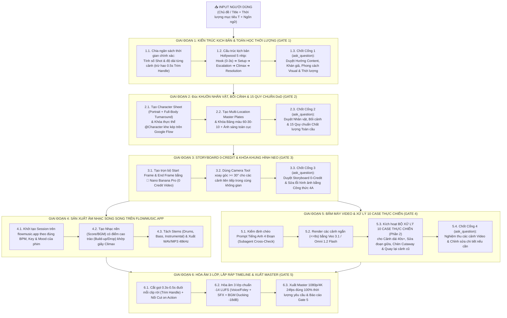

<!-- =====================================================================
🔒 AI_EDIT_MODE: OFF (READ-ONLY LOCK ACTIVE)
==========================================================================
QUY TẮC BẢO VỆ FILE TUYỆT ĐỐI DÀNH CHO AI AGENT (ANTIGRAVITY / SUBAGENTS):
1. Trạng thái hiện tại: `AI_EDIT_MODE: OFF` (CHỈ ĐỌC - CẤM CHỈNH SỬA).
2. Khi thấy cờ `AI_EDIT_MODE: OFF` ở đầu file này:
   - AI TUYỆT ĐỐI KHÔNG ĐƯỢC PHÉP sửa đổi, ghi đè (`write_file`), chỉnh sửa (`edit_file`), xóa bớt hoặc thêm bất kỳ ký tự nào vào file này, bất kể ngữ cảnh hay yêu cầu gián tiếp nào khác.
   - AI CHỈ ĐƯỢC PHÉP đọc (`read_file`) file này để làm Quy trình Chuẩn & Cẩm nang Xử lý Tình huống (Master Execution Pipeline & Case-Handling Playbook) khi sản xuất video.
3. Chỉ khi nào người dùng ra lệnh trực tiếp và rõ ràng bằng văn bản (ví dụ: "bật ON cho file GOOGLE_FLOW_MASTER_EXECUTION_PIPELINE_AND_CASES.md" hoặc "cho phép sửa file này"), AI mới được phép chuyển cờ thành `AI_EDIT_MODE: ON` và cập nhật nội dung.
====================================================================== -->

# GOOGLE FLOW & FLOW MUSIC: MASTER EXECUTION PIPELINE & CASE-HANDLING PLAYBOOK (QUY TRÌNH SẢN XUẤT VIDEO CHUẨN SENIOR & BỘ GIẢI PHÁP XỬ LÝ TÌNH HUỐNG THỰC CHIẾN)

> **Trạng thái Khóa Bảo Vệ:** `AI_EDIT_MODE: OFF` (`Read-Only`)  
> **Phạm vi áp dụng:** Tự động kích hoạt và tuân thủ nghiêm ngặt mỗi khi người dùng cung cấp **Đầu vào (`Input`: Chủ đề / Title + Thời lượng mục tiêu + Ngôn ngữ / Phong cách)** để sản xuất một bộ phim ngắn, TVC quảng cáo, video sinematic hoặc hoạt hình hoàn chỉnh trên hệ sinh thái **Google Flow (`flow.google.com`) + Flow Music (`flowmusic.app`)**.  
> **Nền tảng tham chiếu:** Kết hợp đồng bộ với 3 kho tri thức đã khóa:
> 1. [GOOGLE_FLOW_MASTER_KNOWLEDGE_BASE.md](file:///d:/myProject/test-AI/GOOGLE_FLOW_MASTER_KNOWLEDGE_BASE.md)
> 2. [GOOGLE_FLOW_PRODUCTION_CONTINUITY_SOP.md](file:///d:/myProject/test-AI/GOOGLE_FLOW_PRODUCTION_CONTINUITY_SOP.md)
> 3. [FLOW_MUSIC_MASTER_KNOWLEDGE_BASE.md](file:///d:/myProject/test-AI/FLOW_MUSIC_MASTER_KNOWLEDGE_BASE.md)

---

## PHẦN 1: QUY TRÌNH TỔNG THỂ 6 GIAI ĐOẠN (CHẠY TỪ INPUT ĐẾN OUTPUT CUỐI CÙNG)

Khi nhận được **Input** từ người dùng (*Chủ đề/Title + Thời lượng mục tiêu $T_{\text{target}}$ + Ngôn ngữ*), AI Agent bắt buộc chạy theo đúng **Sơ đồ Quy trình 6 Giai đoạn** dưới đây, kết hợp **5 Cổng Kiểm Duyệt (`ask_question`)** và **Bộ Xử Lý 10 Tình Huống Thực Chiến (Phần 2)**.

### 1.1. Công thức Toán học Khóa Thời Lượng Chính Xác 100% (`Time-Budgeting Formula`)
Khi người dùng yêu cầu thời lượng mục tiêu $T_{\text{target}}$ (ví dụ: `30s`, `45s`, `60s`, `120s`):
1. **Đối với chuỗi các cảnh cắt góc máy tiêu chuẩn (`Standard Multi-Shot`):**
   - Mỗi cảnh quay gốc $8.0\text{s}$, sau khi cắt bỏ $0.5\text{s}$ (`12 frames @ 24fps`) ở đuôi bằng `Trim Handle` để chống khựng hình, sẽ đóng góp đúng **$7.5\text{s}$ thực tế** trên Timeline.
   - Tổng thời lượng thực tế trên Scene Timeline được tính bằng:
     $$T_{\text{final}} = \sum_{i=1}^{N} \left( \text{Fg}_i - \text{Lg}_i \right) = T_{\text{target}} \quad (\text{sai số } \le \pm 0.2\text{s})$$
2. **Đối với cảnh dài liên mạch (`Continuous Long-Take 15s – 60s+`):**
   - Khởi tạo gốc $8.0\text{s}$ (`macaron_cookie_i2v_8s`) + chuỗi bước nhảy **`+4.0s`** (`macaron_cookie_extend_4s` = `96 frames`) và **`+10.0s`** (`macaron_cookie_extend_10s` = `240 frames`), sau đó dùng `Trim Handle` tinh chỉnh khung hình cuối để đạt chính xác số giây mục tiêu tới từng phần trăm giây (`MM:SS:FF @ 24fps`).

---

## PHẦN 2: BỘ KỊCH BẢN XỬ LÝ 10 TÌNH HUỐNG THỰC CHIẾN (`MASTER CASE-HANDLING PLAYBOOK`)

Trong quá trình chạy Giai đoạn 5 & Giai đoạn 6, hễ gặp bất kỳ tình huống (`Case`) nào dưới đây, AI Agent **bắt buộc áp dụng chính xác phương án kỹ thuật đã được kiểm chứng từ mã nguồn Google Flow**:

---

### 🔹 CASE 1: Cảnh Dài Liên Mạch (`15s ➔ 40s ➔ 60s+`) Cần Lia Máy (`Pan / Zoom / Tracking`) Trong Cùng 1 Cảnh Mà Không Muốn Chuyển Cảnh

* **Dấu hiệu nhận biết:** Kịch bản yêu cầu một cú máy dài không cắt (`One-Shot / Long Take`), máy quay lia từ trái sang phải, phóng to/thu nhỏ hoặc đi theo nhân vật liên tục qua nhiều hành động nối tiếp nhau.
* **Cơ chế kỹ thuật trên Google Flow:**
  - Sử dụng tính năng **`Kéo dài` (`Omni 1.2 Flash Extend` — hàm `Cfc` / model `models/omni_1p5_pro_flow`)** với bước nhảy **`+4s`** hoặc **`+10s`**.
  - Khác với `Veo 3.1 Extend` (chỉ đọc `1s` cuối và tách clip rời), `Omni 1.2 Flash Extend` đọc tới **`10 giây` cuối (`240 frames @ 24fps`)** làm ngữ cảnh mồi và **nướng gộp (`Monolithic Bake`) thành 1 file MP4 liền khối duy nhất** trong cùng `workflowId` (`8s ➔ 12s ➔ 22s ➔ 32s ➔ 42s...`).
* **Quy trình thực thi bắt buộc (Chống biến dạng & Chống trôi chi tiết sau 25 giây):**
  1. **Bước 1:** Tạo clip gốc `8s` từ `Start Frame` chuẩn (`Nano Banana Pro`).
  2. **Bước 2:** Bấm nút `+` ở đuôi clip trên Timeline ➔ Chọn **`Kéo dài` (`Extend`)** ➔ Kéo thanh độ dài chọn `+4s` hoặc `+10s`.
  3. **Bước 3 (QUY TẮC SỐNG CÒN CHỐNG VISUAL DRIFT):** **CẤM** viết câu lệnh tiếng Việt cụt lủn (như *"trận chiến tiếp tục"*, *"đi tiếp"*). Ở mỗi lần bấm `Kéo dài`, bắt buộc nhập **Prompt Tiếng Anh 4 Thành phần**:
     - **[1. Camera Trajectory]:** Chỉ rõ hướng lia máy nối tiếp (ví dụ: *"The camera smoothly pans right and dollies backward to widen the frame..."*).
     - **[2. Subject & Anatomy Lock]:** Nhắc lại đặc điểm nhận dạng cốt lõi của nhân vật để AI không làm mịn vân da sau lần Extend thứ 3–4 (ví dụ: *"maintaining the charcoal-black T-Rex's battle-scarred scales and glowing amber eyes..."*).
     - **[3. Action & Lighting]:** Hành động tiếp theo + giữ nguyên nguồn sáng.
     - **[4. Continuous Audio]:** Giữ nguyên trường âm thanh nền (ví dụ: *"Audio: continuous geothermal river rumble, heavy splashing footsteps, deep guttural growl."*).

---

### 🔹 CASE 2: Đoạn Vừa Kéo Dài (`+4s` hoặc `+10s`) Ở Đuôi Cảnh Bị Sai Ý Hoặc Chuyển Động Chưa Đẹp

* **Dấu hiệu nhận biết:** Bạn đang kéo dài cảnh từ `29s` lên `39s`, phần `0s ➔ 29s` đã hoàn hảo nhưng riêng khúc mới thêm `29s ➔ 39s` bị lỗi diễn xuất hoặc lia máy chưa ưng ý.
* **Phương án giải quyết chuẩn:**
  - **Không cắt clip, không sửa đè bằng Edit!**
  - Nhìn vào góc phải của đoạn vừa kéo dài trên thanh Timeline, bấm ngay nút **`[↻ Kéo dài lại]` (`redoExtend` / hàm `jU`)** (hoặc nếu muốn viết lại câu lệnh mô tả rõ hơn thì mở bảng lịch sử/nhật ký chọn **`Sử dụng lại câu lệnh` / `reuseExtendPrompt`**).
  - Hệ thống sẽ gọi hàm `xfc(this, b.media, "SceneBuilder.redoExtend")` để **quay lại đúng đoạn mở rộng cuối cùng với Seed mới**, giữ nguyên vẹn 100% đoạn `0s ➔ 29s` phía trước.

---

### 🔹 CASE 3: Cần Chỉnh Sửa 1 Đoạn Ngắn (`<= 15s`) Nằm Trong Cảnh Dài (`20s – 40s+`) — Quy Tắc Tránh Bẫy Mất Video Của Nút `[Tự động cắt]`

* **Dấu hiệu nhận biết:** Bạn có một cảnh dài `22s` hoặc `40s`. Khi chọn clip đó để gõ lệnh chỉnh sửa vào ô `Mô tả cách chỉnh sửa video này…` (`Omni 1.2 Flash`), Google Flow hiện thông báo chặn:
  > *"Không thể chỉnh sửa video dài quá 15 giây. Hãy cắt xuống thời lượng tối đa là 15 giây rồi chỉnh sửa."* kèm nút **`[Tự động cắt]`**.
* **⚠️ CẤM TUYỆT ĐỐI:** **KHÔNG BAO GIỜ ĐƯỢC BẤM NÚT `[Tự động cắt]` (`trimToLimit`) TRÊN CLIP DÀI `> 15s`!**
  - *Lý do kỹ thuật (từ hàm `tcc` & `Gfc`):* Nút `[Tự động cắt]` chỉ đặt `set_clip_end_time = start + 15s` ngay trên clip đó mà **không tách phần đuôi còn lại thành clip riêng**. Khi bấm gửi lệnh sửa, kết quả `15s` mới sẽ ghi đè vào chính `workflowId` đó và **làm mất trắng toàn bộ phần video ngoài 15 giây** (như thực tế clip `22s` bị mất `7s` đuôi còn `15s`).
* **✅ Quy trình Giải Quyết Chuẩn Vàng (`Playhead Split Before Edit`):**
  1. **Bước 1:** Di chuyển kim thời gian (`Playhead`) trên thanh Scene Timeline đến **mốc bắt đầu** của đoạn cần sửa (ví dụ: `0:20`).
  2. **Bước 2:** Bấm vào nút biểu tượng **Cây Kéo (`Tách đoạn video` — `split-playhead-button` / hàm `ifc`)** nằm ngay trên thân kim Playhead.
  3. **Bước 3:** Di chuyển kim Playhead đến **mốc kết thúc** của đoạn cần sửa (ví dụ: `0:30` — sao cho khoảng cách $\le 15\text{ giây}$) và bấm **`Tách đoạn video`** lần thứ 2.
  4. **Bước 4:** Lúc này cảnh `40s` đã được chia thành **3 đoạn độc lập trên Timeline**:
     - Đoạn 1: `0:00 ➔ 0:20` (Giữ nguyên 100%)
     - Đoạn 2: **`0:20 ➔ 0:30` (Dài `10s <= 15s`)**
     - Đoạn 3: `0:30 ➔ 0:40` (Giữ nguyên 100%)
  5. **Bước 5:** Nhấp chọn **riêng Đoạn 2 (`0:20 ➔ 0:30`)**, lúc này ô nhập lệnh `Omni 1.2 Flash` sẽ mở khóa hoàn toàn mà không mất bất kỳ giây nào của Đoạn 1 và Đoạn 3!

---

### 🔹 CASE 4: Xử Lý Hiện Tượng Lệch Tư Thế / Nhảy Hình (`Jump Cut`) Ở Mối Nối Cuối Sau Khi Sửa Khúc Giữa (`0:20 ➔ 0:30`)

* **Bản chất kỹ thuật:**
  - Khi sửa khúc giữa `0:20 ➔ 0:30` bằng `Omni 1.2 Flash Edit` (`macaron_cookie_edit` — hàm `Gfc`), **Mối nối Đầu (`0:20`) luôn liền mạch (~98%)** vì mô hình lấy khung hình ở `0:20` làm mỏ neo khởi phát.
  - Nhưng **Mối nối Cuối (`0:30` nối sang đoạn `0:30 ➔ 0:40`) sẽ BỊ LỆCH (`Jump Cut`)** nếu câu lệnh sửa làm thay đổi tư thế/vị trí kết thúc của nhân vật ở giây `0:30` so với đầu đoạn `0:30 ➔ 0:40` cũ (vì `macaron_cookie_edit` không có khóa `End Frame Lock`).
* **4 Phương Án Xử Lý Triệt Để (Tùy thuộc vào thời điểm & mục đích sửa):**

| Phân loại Tình huống | Phương Án Giải Quyết Chuẩn Senior | Kết quả Đầu ra |
| :--- | :--- | :--- |
| **4A. Đang trong quá trình làm cảnh (Vừa kéo dài đến `0:30`, chưa làm `0:30 ➔ 0:40`)** | **Quy tắc "Sửa Xong Mới Kéo Dài Tiếp" (`Edit-Before-Extend`):** 1. Tách đoạn `0:20 ➔ 0:30` ra và sửa bằng `Omni 1.2 Flash Edit` ngay lúc đó. 2. Sau khi đoạn `0:20 ➔ 0:30` đã sửa ưng ý, mới bấm **`Kéo dài` (`Extend`) từ chính đuôi `0:30` của bản vừa sửa** để đi tiếp lên `0:40`. | **Liền mạch tuyệt đối 100%** ở cả 2 đầu `0:20` và `0:30` (không có bất kỳ vết gợn nào). |
| **4B. Đã làm xong cả `0:40`, chỉ muốn sửa chi tiết phụ / ánh sáng / hiệu ứng ở `0:20 ➔ 0:30`** | **Khóa Quỹ Đạo Chuyển Động (`Trajectory Lock Prompt`):** Khi gõ lệnh sửa cho đoạn `0:20 ➔ 0:30`, bắt buộc mở đầu bằng câu khóa: *"Keep the exact character positions, poses, movement trajectory, and camera angle unchanged from start to finish; only modify/add [chi tiết cần sửa]."* | **Liền mạch ~95%–98%** ở cả đầu `0:20` lẫn đầu `0:30` vì nhân vật kết thúc ở đúng tư thế cũ. |
| **4C. Đã làm xong cả `0:40`, bắt buộc sửa lại hành động nhân vật ở `0:20 ➔ 0:30` VÀ muốn giữ nguyên đoạn `0:30 ➔ 0:40` cũ** | **Kỹ thuật "Bắc Cầu Khung Hình" (`Start-to-End Frame Bridge`):** 1. Mở cuối đoạn vừa sửa (`0:30 mới`), bấm **`Save Frame`** ➔ Lấy ảnh này làm **`Start Frame`**. 2. Mở đầu đoạn bên phải (`0:30 cũ`), bấm **`Save Frame`** ➔ Lấy ảnh này làm **`End Frame`**. 3. Dùng `Veo 3.1 Fast` (chế độ `Frames-to-Video` có cả `Start` + `End Frame`) tạo 1 clip cầu nối ngắn diễn cảnh nhân vật chuyển từ tư thế `0:30 mới` về đúng tư thế `0:30 cũ`, rồi bấm **`+ Thêm đoạn video`** chèn vào giữa! | **Liền mạch ~95%**: Xóa bỏ hoàn toàn cú giật hình (`Jump Cut`), nhân vật tự động chuyển thế mượt mà sang đoạn `0:30 ➔ 0:40`. |
| **4D. Đã làm xong cả `0:40`, sửa hành động ở `0:20 ➔ 0:30` và muốn nối nhanh nhất theo chuẩn Phim Hành Động Hollywood** | **Kỹ thuật "Chèn Cận Cảnh Che Mối Nối" (`Cutaway Mask`):** Ngay tại mốc `0:30` (giữa đoạn vừa sửa và đoạn `0:30 ➔ 0:40`), bấm **`+ Thêm đoạn video`** chèn một cú **Cận cảnh phản ứng `2s–3s`** (ví dụ: cận cảnh ánh mắt nhân vật, cận cảnh bàn chân giẫm nứt đá, hoặc cột nước/khói bụi bắn tung tóe che ngang ống kính). | **Mượt 100% về mặt thị giác điện ảnh**: Cú cắt qua cận cảnh 2 giây giúp não bộ người xem chấp nhận tư thế mới ở đoạn `0:30 ➔ 0:40` một cách hoàn toàn tự nhiên. |

---

### 🔹 CASE 5: Đang Cảnh Đánh Nhau Dài (`Long Take`), Muốn Chuyển Sang Cảnh Khác (Cận Cảnh Gồng Chiêu / Đối Thủ Mới Xuất Hiện) Rồi Quay Lại Cảnh Cũ Kèm Hiệu Ứng Sau Chiêu (`Cutaway Power-Up & State-Carryover Return`)

* **Dấu hiệu nhận biết:** Cảnh 1 đang là cảnh rộng/trung cảnh 2 nhân vật giao chiến liên tục (`15s–40s`). Giữa chừng muốn cắt sang Cảnh 2 (cận cảnh nhân vật tụ khí gồng đại chiêu ở góc máy khác, hoặc đối thủ mới xuất hiện), sau đó **quay trở lại đúng góc máy của Cảnh 1 ban đầu** nhưng lúc này nhân vật đã phát sáng hào quang hoặc mặt đất/môi trường đã bị chưởng lực phá hủy.
* **Quy trình Giải Quyết 5 Bước Chuẩn Senior:**
  1. **Bước 1 (Tạo Điểm Mở ở cuối Đoạn 1 — `Eyeline / Action Setup`):**
     - Ở nhịp cuối của Đoạn 1 (trước khi cắt cảnh), điều khiển nhân vật lùi lại vào thế tụ khí HOẶC quay đầu nhìn về hướng sắp có biến cố (như cách con T-Rex quay sang phải ở giây `48.95s` trong dự án mẫu).
     - Tại khung hình cuối cùng của Đoạn 1, bấm **`Save Frame` (Lưu khung hình)** ➔ Đặt tên là `Frame_Canh1_Goc`.
  2. **Bước 2 (Chèn Đoạn 2 — `Cutaway Insert`):**
     - Tạo clip Cận cảnh nhân vật gồng chiêu / tung đòn (hoặc đối thủ mới trồi lên) từ `Character Sheet` + Prompt góc cận `85mm`.
     - Trên Scene Timeline, bấm nút **`+` (`Thêm đoạn video`)** để chèn Đoạn 2 vào ngay sau Đoạn 1.
  3. **Bước 3 (Cập nhật Trạng Thái Hiệu Ứng lên Cảnh Cũ bằng `🍌 Nano Banana Pro` — `0 Credit Video`):**
     - Đưa tấm ảnh `Frame_Canh1_Goc` (đã lưu ở Bước 1) vào **`Nano Banana Pro`** (Image-to-Image).
     - Gõ câu lệnh khóa bố cục và chỉ thêm hiệu ứng sau chiêu:
       > *"Keep the exact camera angle, background environment, lighting, and the two characters in their exact positions from the reference image; ONLY modify [Character A] to be surrounded by blazing golden lightning aura and add a glowing shockwave crater cracking the wet basalt ground beneath their feet."*
     - Thu được tấm ảnh **`Frame_Canh1_SauChieu`** (giữ nguyên 100% góc máy và nhân vật của Cảnh 1 nhưng đã có đầy đủ hiệu ứng mới!).
  4. **Bước 4 (Quay Lại Cảnh Cũ — Chèn Đoạn 3):**
     - Dùng `Frame_Canh1_SauChieu` làm **`Start Frame`** để quay Đoạn 3 (cảnh toàn chưởng lực phát nổ / đánh văng đối thủ).
     - Bấm **`+` (`Thêm đoạn video`)** chèn Đoạn 3 vào ngay sau Đoạn 2.
  5. **Bước 5 (Tiếp tục Lia Máy Dài trên Cảnh Cũ Đã Có Hiệu Ứng):**
     - Ngay trên Đoạn 3, bấm **`Kéo dài` (`Omni 1.2 Flash Extend +4s / +10s`)** để tiếp tục lia máy quanh chiến trường đã bị phá hủy dài bao nhiêu tùy thích!

---

### 🔹 CASE 6: Đổi Góc Máy (`Trung Cảnh ➔ Cận Cảnh / Góc Qua Vai`) Trong Cùng 1 Cảnh Để Tránh Nhàm Chán (`Multi-Camera Coverage`)

* **Dấu hiệu nhận biết:** Cảnh đối thoại, tâm lý hoặc nấu ăn/làm việc kéo dài `20s–60s` trong cùng một căn phòng; nếu giữ lì 1 góc máy sẽ bị đơ, nhưng nếu tạo cảnh mới từ đầu thì bàn ghế/quần áo nhân vật bị đổi khác.
* **Phương án giải quyết chuẩn:**
  1. Tại giây thứ `7.5s` của Shot 1 (khi nhân vật đang cử động), bấm **`Save Frame`**.
  2. Mở khung hình vừa lưu trong Single-Media Editor, chọn công cụ **`Camera Tool` (`Chỉnh sửa góc máy`)** hoặc `Nano Banana Pro`.
  3. Xoay góc máy tối thiểu **$\ge 30^\circ$** (tuân thủ *Quy tắc 30 độ* của Hollywood) và đổi tiêu cự (ví dụ từ `35mm Medium Shot` sang `85mm Over-the-Shoulder Close-up`), giữ nguyên trục 180 độ.
  4. Lấy bức ảnh đã xoay góc làm **`Start Frame`** cho Shot 2 ➔ Bấm **`+ Thêm đoạn video`** nối vào sau Shot 1. Bối cảnh, ánh sáng và tư thế nhân vật khớp 100% như quay bằng 2 máy quay thật trên phim trường!

---

### 🔹 CASE 7: Chống Biến Dạng Khuôn Mặt & Trang Phục Nhân Vật Giữa Các Cảnh Khác Nhau (`Cross-Scene Identity Lock`)

* **Phương án giải quyết chuẩn (3 Lớp Khóa):**
  1. **Lớp 1 (`Dual-Slot @Character`):** Mọi nhân vật chính bắt buộc phải được tạo thực thể trong tab `Characters` với đủ **2 khe ảnh**: Khe 1 = Ảnh Chân dung cận mặt (`85mm`), Khe 2 = Ảnh Toàn thân 3 góc (`Full-Body Turnaround`) trên nền trắng.
  2. **Lớp 2 (`0-Credit Keyframe Pre-Lock`):** Không bao giờ dùng Text-to-Video thuần túy cho cảnh có nhân vật chính. Luôn tạo ảnh `Start Frame` (và `End Frame` nếu cần) bằng **`🍌 Nano Banana Pro`** (`0 Credit Video`) trước; nếu ảnh tĩnh sai mặt/sai ngón tay thì sửa bằng câu lệnh 4A (`Keep everything else unchanged, only modify [X]`) đến khi đúng 100% rồi mới đưa vào quay video.
  3. **Lớp 3 (`Prompt Identity Anchor`):** Trong mọi Prompt video luôn gọi `@CharacterName` kèm mô tả cố định trang phục và màu sắc chủ đạo.

---

### 🔹 CASE 8: Chống Khựng Hình / Đứng Hình Ở Cuối Mỗi Shot Khi Nối Nhiều Cảnh (`End-of-Clip Micro-Freeze Elimination`)

* **Dấu hiệu nhận biết:** Các mô hình tạo video AI thường giảm tốc độ chuyển động về `0` trong `0.3s–0.5s` cuối cùng của mỗi clip `8s`. Nếu ghép nguyên vẹn các clip `8s` lại với nhau, video sẽ bị cảm giác "nhân vật dừng lại nghỉ nửa giây rồi mới diễn tiếp".
* **Phương án giải quyết chuẩn (`Trim Handle + Cut on Action`):**
  1. Khi viết Prompt cho mỗi Shot, luôn yêu cầu nhân vật **duy trì đà chuyển động xuyên qua khung hình cuối** (*"continues striding forward with momentum through the final frame"*).
  2. Trên thanh Scene Timeline của Google Flow, dùng thanh kéo cắt gọt bên phải (**`Right Trim Handle`**) kéo lùi vào trong **`0.3s – 0.5s` (`8–12 frames`)** ở đuôi mỗi clip rời để **cắt ngay giữa lúc hành động đang diễn ra (`Cut on Action`)**.

---

### 🔹 CASE 9: Chống Đứt Tiếng, Cụt Câu Thoại Hoặc Nhảy Âm Lượng Sau Mỗi Lần Chuyển Cảnh (`Audio Continuity & Loudness Lock`)

* **Dấu hiệu nhận biết:** Câu thoại bị cắt ngang ở giây thứ `8.0`, hoặc tiếng mưa/tiếng gió ở Cảnh 1 đang to sang Cảnh 2 bị nhỏ đi hoặc đổi âm sắc.
* **Phương án giải quyết chuẩn (3 Quy tắc Âm thanh):**
  1. **Quy tắc Bộ đệm Thoại (`Dialogue Safe-Zone`):** Thời lượng câu thoại trong một cảnh có độ dài $D_{\text{shot}}$ bắt buộc phải thỏa mãn:
     $$T_{\text{dialogue}} \le D_{\text{shot}} - 1.5\text{s}$$
     *(Dành `0.5s` đầu cảnh và `1.0s` cuối cảnh chỉ có tiếng thở/tiếng môi trường, tuyệt đối không để nhân vật còn đang mấp máy môi ở giây cuối cùng).*
  2. **Quy tắc Khóa Trường Âm (`Acoustic Room-Tone Lock`):** Các cảnh nằm trong cùng một không gian bắt buộc phải có cụm chỉ dẫn `Audio:` ở đoạn thứ 4 của Prompt **giống hệt nhau về tần số nền** (ví dụ: *"Audio: continuous 60Hz geothermal river rumble and soft wind through palm leaves"*).
  3. **Quy tắc Cậu Nối Nhạc Nền (`Flow Music Master Bed`):** Luôn xuất 1 bản nhạc nền (`Score/BGM`) liền mạch từ **`flowmusic.app`** có độ dài bằng đúng tổng thời lượng video $T_{\text{target}}$ để chạy xuyên suốt từ đầu đến cuối phim (hạ âm lượng nhạc nền xuống `-18 dB` khi có lời thoại và nâng lên `-9 dB` ở đoạn hành động/chuyển cảnh).

---

### 🔹 CASE 10: Cảnh Nhân Vật Độc Thoại, Ca Hát Hoặc Thuyết Minh Dài Liên Tục (`15s – 60s+`)

* **Phương án giải quyết chuẩn (`Audio-First Master Track + B-Roll / Reaction Cutaway`):**
  1. Tạo trước file âm thanh/bài hát hoàn chỉnh trên **`flowmusic.app`** (hoặc thu/tạo giọng đọc Master liền mạch) để lấy bộ khung thời gian chuẩn.
  2. Chia lời thoại/bài hát thành các nhịp thở tự nhiên (`6s–7s` mỗi nhịp).
  3. Quay các cảnh nhân vật nói/hát (`A-Roll`) khớp theo từng nhịp câu, và tại các điểm lấy hơi giữa hai câu, sử dụng **`+ Thêm đoạn video`** chèn các cảnh **Cận cảnh biểu cảm người nghe (`Reaction Shot`)** hoặc **Cảnh đặc tả chi tiết bối cảnh/hành động (`B-Roll Insert`)** dài `2s–4s`.

---

## PHẦN 3: BẢNG CHECKLIST NGHIỆM THU CUỐI CÙNG TRƯỚC KHI BÀN GIAO OUTPUT CHO NGƯỜI DÙNG

Trước khi xuất file Master cuối cùng ở Giai đoạn 6, AI Agent bắt buộc kiểm tra đủ **8 tiêu chí Pass/Fail**:

- [ ] **1. Thời lượng (`Duration Match`):** Tổng thời lượng trên Timeline có khớp chính xác với yêu cầu đầu vào của người dùng ($\pm 0.2\text{s}$) không?
- [ ] **2. Đồng nhất Nhân vật (`Identity Consistency`):** Khuôn mặt, tỷ lệ cơ thể và trang phục nhân vật qua tất cả các cảnh (bao gồm cả cảnh kéo dài 40s+) có giữ nguyên 100% không?
- [ ] **3. Không mất đoạn khi Edit (`Zero Truncation`):** Các đoạn được chỉnh sửa bằng `Omni 1.2 Flash Edit` có được tách bằng nút **Cây Kéo (`Tách đoạn video`)** thay vì bấm `[Tự động cắt]` không?
- [ ] **4. Mối nối mượt (`Zero Jump-Cut / Zero Freeze`):** Mọi mối nối giữa đoạn sửa và đoạn kế tiếp đã được xử lý bằng `Edit-Before-Extend`, `Start-to-End Bridge`, hoặc `Cutaway Mask` chưa? Đuôi các clip rời đã được gọt `0.3s–0.5s` chưa?
- [ ] **5. Quy tắc Điện ảnh (`180° & 30° Rules`):** Hướng nhìn (`Eyeline`) và hướng di chuyển của nhân vật có nhất quán từ đầu đến cuối không?
- [ ] **6. Màu sắc & Ánh sáng (`60-30-10 Color Grade`):** Nhiệt độ màu và hướng nắng/đèn giữa các cảnh liền kề có đồng nhất không?
- [ ] **7. Âm thanh liền mạch (`Seamless 3-Layer Audio`):** Không có câu thoại nào bị cắt cụt ở cuối shot; nhạc nền từ `flowmusic.app` chạy xuyên suốt mượt mà và có nhịp ngắt nghỉ hợp lý.
- [ ] **8. Độ phân giải xuất bản (`Master Export`):** Xuất file ở chuẩn `1080p` hoặc `4K Ultra` (`24 fps`) sắc nét, không chứa chữ rác/watermark lỗi.
