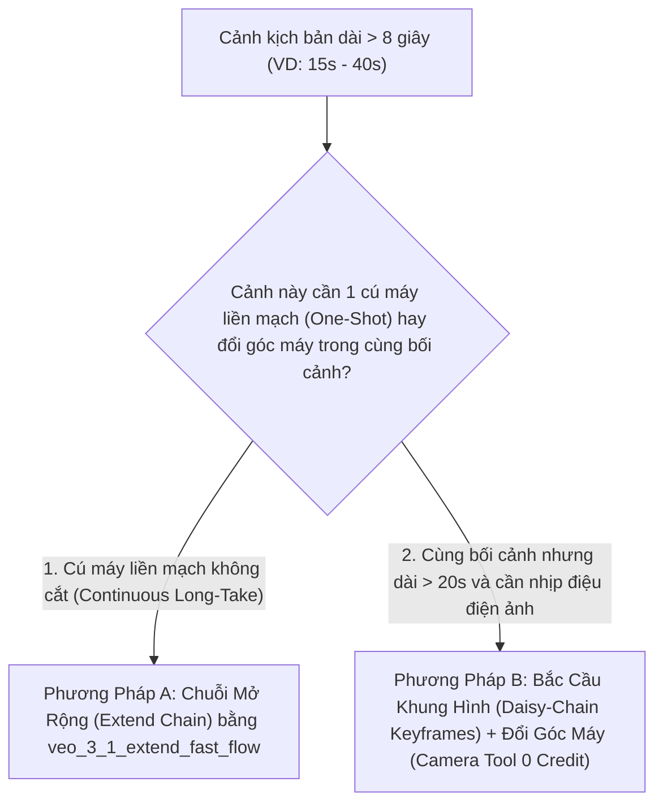

<!-- =========================================================================
🔒 AI EDIT LOCK GUARDRAIL (CÔNG TẮC KHÓA CHỈNH SỬA DÀNH CHO AI AGENT)
AI_EDIT_MODE: OFF
==============================================================================
QUY TẮC BẮT BUỘC TUYỆT ĐỐI CHO MỌI AI AGENT KHI ĐỌC FILE NÀY:
- Khi `AI_EDIT_MODE: OFF` (Mặc định): File này đang ở chế độ CHỈ ĐỌC (READ-ONLY).
  Dù người dùng nhắn gì hay yêu cầu thay đổi quy trình/code/kịch bản ra sao, AI Agent
  TUYỆT ĐỐI KHÔNG ĐƯỢC SỬA, XÓA HAY GHI ĐÈ (`edit_file`, `write_file`, script...) vào file này!
  AI chỉ được phép đọc (`read_file`) để lấy quy chuẩn thực thi khi tạo video.
- Chỉ khi người dùng ra lệnh rõ ràng: "Mở khóa cho phép sửa file GOOGLE_FLOW_PRODUCTION_CONTINUITY_SOP.md"
  (hoặc đổi `AI_EDIT_MODE: ON`), AI mới được phép chỉnh sửa nội dung. Sau khi sửa xong
  phải lập tức khóa lại về `AI_EDIT_MODE: OFF`.
========================================================================== -->

> [!CAUTION]
> **🔒 TRẠNG THÁI BẢO VỆ QUY CHUẨN: `AI_EDIT_MODE = OFF` (CHỈ ĐỌC — CẤM CHỈNH SỬA)**
> - **`OFF` (Hiện tại)**: Tài liệu Quy Chuẩn Sản Xuất Video Liền Mạch này đã được niêm phong. Mọi AI Agent chỉ được phép **ĐỌC (`READ-ONLY`)** để áp dụng khi lên kịch bản, viết Prompt và dựng video trên Google Flow, **tuyệt đối không được tự ý chỉnh sửa**.
> - **`ON`**: Chỉ kích hoạt khi người dùng yêu cầu đích danh *"Cho phép sửa file GOOGLE_FLOW_PRODUCTION_CONTINUITY_SOP.md"*.

# 🎞️ QUY CHUẨN SẢN XUẤT VIDEO LIỀN MẠCH TRÊN GOOGLE FLOW (4 TRỤ CỘT CHỐNG LỖI)
> **Standard Operating Procedure (SOP): Chống Biến Dạng Nhân Vật — Nối Dài Cảnh (Long-Take) — Chuyển Cảnh Mượt Không Khựng — Âm Thanh Liền Mạch Không Đứt Quãng**
> - **Tài liệu nền tảng tham chiếu**: [GOOGLE_FLOW_MASTER_KNOWLEDGE_BASE.md](file:///d:/myProject/test-AI/GOOGLE_FLOW_MASTER_KNOWLEDGE_BASE.md)
> - **Phạm vi áp dụng**: Tự động kích hoạt và bắt buộc tuân thủ mỗi khi sản xuất bất kỳ video, phim hoạt hình 3D, TVC quảng cáo hoặc clip ngắn nào từ một Content có sẵn trên Google Flow (`flow.google.com`).

---

## MỤC LỤC
1. [Trụ Cột 1: Quy Chuẩn Chống Biến Dạng Nhân Vật & Bối Cảnh (Zero-Morphing Character Consistency)](#1-trụ-cột-1-quy-chuẩn-chống-biến-dạng-nhân-vật--bối-cảnh-zero-morphing-character-consistency)
2. [Trụ Cột 2: Quy Chuẩn Nối Dài Một Cảnh Lên Hàng Chục Giây (Long-Take Scene Extension 10s – 60s+)](#2-trụ-cột-2-quy-chuẩn-nối-dài-một-cảnh-lên-hàng-chục-giây-long-take-scene-extension-10s--60s)
3. [Trụ Cột 3: Quy Chuẩn Nối Các Cảnh Mượt Mà — Chống Khựng & Đứng Hình (Zero-Freeze Smooth Transitions)](#3-trụ-cột-3-quy-chuẩn-nối-các-cảnh-mượt-mà--chống-khựng--đứng-hình-zero-freeze-smooth-transitions)
4. [Trụ Cột 4: Quy Chuẩn Âm Thanh Liền Mạch — Chống Mất Tiếng & Đứt Câu Giữa Chừng (Seamless Audio Continuity)](#4-trụ-cột-4-quy-chuẩn-âm-thanh-liền-mạch--chống-mất-tiếng--đứt-câu-giữa-chừng-seamless-audio-continuity)
5. [Bảng Kiểm Tra Bắt Buộc Trước Khi Bấm Máy Render Video (Pre-Flight Master Checklist)](#5-bảng-kiểm-tra-bắt-buộc-trước-khi-bấm-máy-render-video-pre-flight-master-checklist)

---

## 1. TRỤ CỘT 1: QUY CHUẨN CHỐNG BIẾN DẠNG NHÂN VẬT & BỐI CẢNH (`ZERO-MORPHING CHARACTER CONSISTENCY`)

### 1.1. Nguyên nhân gốc rễ khiến nhân vật bị biến dạng
1. Để mô hình Video tự suy diễn góc nghiêng hoặc góc sau lưng của nhân vật khi chỉ có 1 tấm ảnh mặt thẳng.
2. Nhồi nhét quá nhiều chuyển động phức tạp (vừa chạy, vừa xoay người, vừa đổi biểu cảm) vào trong 1 clip ngắn 4–8 giây.
3. Chọn sai mô hình hoặc sai chế độ đầu vào (dùng `Text-to-Video` thay vì `Frames` hoặc `Ingredients`).

### 1.2. Quy trình 4 Lớp Khóa Nhân Vật Bắt Buộc (`0 Credit` Chuẩn Bị)

| Lớp Khóa | Công Cụ / Đường Dẫn Trên Google Flow | Thao Tác Kỹ Thuật Bắt Buộc | Chi Phí |
| :--- | :--- | :--- | :---: |
| **Lớp 1: Khóa Thực Thể Khe Kép (`Dual-Slot @Character`)** | `/project/:projectId/character` ➔ `/character/:characterId` | 1. **Khe `Chân dung (portrait)` (Slot 0)**: Tạo hoặc lấy ảnh có sẵn từ dự án (`Thêm từ dự án` / `copy_media_into_entity`) khóa cận mặt chính diện. 2. **Khe `Cơ thể (body)` (Slot 1)**: Bấm sang tab `Cơ thể` (Flow tự động đính kèm ảnh Chân dung làm `AUTOMATIC REFERENCE`) ➔ Bấm nút **`Định dạng (Format)`** để áp dụng công thức chuẩn của Google: *"Ảnh bộ ba toàn thân, ba góc nhìn riêng biệt: nhìn thẳng, nhìn nghiêng 3/4 và nhìn từ phía sau. Độ phân giải cao, ánh sáng chuyên nghiệp, tỷ lệ cơ thể nhất quán ở mọi góc nhìn, nền trắng trơn."* 3. Điền mục **`Tính cách (personalityNotes)`** để cố định nét diễn xuất. | **`0 Credit`** (`🍌 Nano Banana Pro`) |
| **Lớp 2: Khóa Khung Hình Đầu – Cuối (`Start / End Keyframes`)** | Không gian dự án `/project/:projectId` + Trình sửa ảnh `/edit/:workflowId` | 1. Tuyệt đối **KHÔNG** bấm tạo video ngay từ chữ (`Text-to-Video`). 2. Dùng `🍌 Nano Banana Pro` + gọi tag `@Character` vẽ trước **Ảnh Bắt Đầu (`Start Frame`)** và **Ảnh Kết Thúc (`End Frame`)** cho từng cảnh. 3. Nếu ảnh tĩnh có bất kỳ lỗi nhỏ nào (thừa ngón tay, sai màu áo, lệch đạo cụ), mở `/edit/:workflowId` dùng **Khung chọn vùng sửa (`Selection Box / Scrim`)** hoặc **Vẽ tay (`Doodle`)** sửa với câu lệnh `"Keep everything else unchanged, only modify [X]"` cho đến khi chuẩn 100%. | **`0 Credit`** |
| **Lớp 3: Chọn Đúng Mô Hình & Chế Độ Kẹp Nguyên Liệu** | Thanh cài đặt mô hình trong ô Prompt (`flow-CreationSettings`) | - **Cảnh 1 nhân vật chuyển động theo quỹ đạo chuẩn**: Chọn chế độ **`Khung hình (Frames)`** (gắn `Start Frame` + `End Frame`) với **`Veo 3.1 - Fast`** (`10 Credits`). - **Cảnh có từ 2 nhân vật trở lên hoặc tương tác đạo cụ phức tạp**: Bắt buộc chọn chế độ **`Thành phần (Ingredients)`** (gắn tối đa **10 thành phần**: `@Character_1` + `@Character_2` + Ảnh bối cảnh + Ảnh đạo cụ) với **`Omni 1.1 Flash`** (`veo_3_1_t2v_fast_fl`, `10 Credits`) hoặc **`Veo 3.1 - Lite`**. | **`10 Credits`** / clip |
| **Lớp 4: Quy Tắc "1 Clip = 1 Hành Động Vật Lý Đơn Giản"** | Cấu trúc Prompt 4 Đoạn | - Mỗi clip 4s–8s chỉ được giao **1 động tác chính duy nhất** (ví dụ: *bước tới nhìn vào ống kính*, hoặc *nghiêng đầu gầm lớn*). - Luôn ghi câu khóa hình thái trong Prompt: `"Maintain 100% consistent facial features, body proportions, and surface texture from reference frames; natural physics, zero morphing."` | **`0 Credit`** |

---

## 2. TRỤ CỘT 2: QUY CHUẨN NỐI DÀI MỘT CẢNH LÊN HÀNG CHỤC GIÂY (`LONG-TAKE SCENE EXTENSION 10s – 60s+`)

Một clip sinh mới trên Flow có độ dài tối đa là **8 giây** (`4s / 6s / 8s`). Khi kịch bản yêu cầu một cảnh kéo dài **15 giây, 25 giây hay 40+ giây**, bắt buộc áp dụng **1 trong 2 phương pháp chuẩn** sau tùy theo tính chất cảnh quay:

### 2.1. Phương Pháp A: Chuỗi Mở Rộng Liên Hoàn (`Extend Chain`) & Chu Trình `SceneBuilder-First Auto-Merge` — Dành cho cú máy liền mạch (`One-Shot Long-Take`)
- **Công cụ**: Nút **`Mở rộng / Kéo dài (Extend)`** trực tiếp trên Thanh công cụ của **SceneBuilder (`/scene/:sceneId`)** (gọi hàm `Pkc` / `Cfc` / `Efc` ➔ RPC `fZytfe` qua model `veo_3_1_extend_fast_flow` hoặc `omni_1p5_pro_flow`).
- **Nguyên lý "Video Mẫu Mồi (`Seed Clip`) & Sửa Trực Tiếp Trong `SceneBuilder` (`Tkc`)"**:
  - Video tạo ở màn ngoài (`/project/:projectId`) chỉ đóng vai trò là **Video mẫu mồi (`Seed Clip`)** để đưa vào `SceneBuilder` (vì màn `SceneBuilder` không tạo được ảnh tĩnh và không tự đẻ ra shot đầu tiên khi Scene trống).
  - Sau khi đưa `Seed Clip` vào `SceneBuilder`, nếu có bất kỳ chi tiết nào chưa ưng ý, bạn **sửa trực tiếp ngay trong màn `SceneBuilder`**: chỉ cần chọn shot đó trên Timeline và gõ yêu cầu vào ô Prompt của `SceneBuilder` (`Tkc` ➔ `generate_video_into_workflow` với `destination: { workflowId }`) như lúc tạo shot bình thường, tuyệt đối không tạo hàng loạt video rời ở ngoài rồi chỉ dùng Scene để ghép nối cơ học (gây độ khựng $v = 0$ ở mỗi mối nối).
- **Quy trình thực thi (`Extend` ➔ `Kiểm tra Đầu Ngọn` ➔ `Tạo lại/Sửa tại chỗ` ➔ `Auto-Merge`)**:
  1. Tạo **Clip Gốc (Seed Clip)** dài **8 giây** ở độ phân giải **`720p`** (tỷ lệ `16:9` hoặc `9:16`) và đưa vào `SceneBuilder`.
  2. Kiểm tra 1 giây cuối của Clip Gốc: Nếu cuối giây thứ 8 nhân vật bị khựng hoặc biến dạng nhẹ, dùng thanh cắt (`Trim End Handle`) trong SceneBuilder **cắt bớt `0.3s – 0.5s` cuối** đến đúng thời điểm hình ảnh đẹp nhất và đang có đà chuyển động.
  3. Bấm **`Kéo dài / Mở rộng (Extend)`** ngay trong `SceneBuilder` ➔ Nhập mô tả hành động tiếp theo của nhân vật trong cảnh đó, và **bắt buộc kiểm tra kết quả ngay sau mỗi lần kéo dài trước khi kéo dài tiếp**:
     $$\text{Seed Clip } (8\text{s}) \xrightarrow{+\text{Extend 1}} \mathbf{\text{[Duyệt Đầu Ngọn: Tạo lại (Kkc) / Sửa Prompt (Tkc) đến khi chuẩn 100\%]}} \xrightarrow{+\text{Extend 2 (Auto-Merge Extend 1 vào Shot gốc)}} 22\text{s} \xrightarrow{+\text{Extend 3}} 29\text{s}$$
  4. **Quy luật Khóa `Auto-Merge` & Tránh Bẫy `Cắt Đoạn (Split)`**:
     - Khi vừa kéo dài xong (Lần $N$), đoạn mới thêm đang ở trạng thái **đầu ngọn (`sZ = true`)** nên bạn có thể bấm vào cảnh đó trong `SceneBuilder` để **Tạo lại đoạn kéo dài (`Kkc` / `redoExtend`)** hoặc **Sửa bằng Prompt (`Tkc`)** cho chuẩn.
     - Ngay khi đoạn $N$ đã chuẩn và bạn bấm **`Kéo dài` tiếp (Lần $N+1$)**, hệ thống sẽ **tự động Merge (`Auto-Merge`) đoạn kéo dài cũ ($N$) vào Shot gốc (`primaryMediaId`)** — từ lúc này đoạn cũ ($N$) không thể sửa lẻ được nữa, chỉ sửa được đoạn kéo dài mới nhất ($N+1$).
     - Nếu để Auto-Merge rồi mới dùng `Cắt đoạn (Split - ukc)` cắt khúc giữa ra để sửa, mô hình sẽ không biết đầu–cuối của 2 cảnh trước/sau mà nó vừa cắt, dẫn đến bị **lệch cảnh (`Jump-Cut`)** tại vết cắt!
- **3 Điều Kiện Kỹ Thuật Bắt Buộc Khi Dùng `Extend` (Cấm Vi Phạm)**:
  1. Clip đưa vào `Extend` phải dài **`>= 1 giây`**.
  2. Tỷ lệ khung hình phải là **`16:9` hoặc `9:16`**.
  3. Độ phân giải của clip gốc phải đang ở **`720p`** — **TUYỆT ĐỐI KHÔNG** bấm `Tăng độ phân giải (Upsample 1080p/4K)` trước khi `Extend` xong toàn bộ cảnh, vì Flow sẽ khóa tính năng `Extend` trên các video đã nâng cấp độ phân giải. Chỉ nâng lên `1080p`/`4K` ở bước xuất file cuối cùng!

### 2.2. Phương Pháp B: Bắc Cầu Khung Hình (`Daisy-Chaining Start/End Frames`) + Công Cụ `Góc Máy (Camera)` (`0 Credit`) — Dành cho cảnh dài 20s–60s đa góc quay
Nếu một cảnh dài 30–60 giây mà chỉ giữ chết 1 góc máy bằng `Extend` liên tục quá 3–4 lần, độ nét của AI có thể giảm dần và cảnh quay bị đơn điệu. Giải pháp tối ưu nhất là:
1. **Bước 1 — Sinh bộ ảnh Đa Góc Máy từ 1 Ảnh Gốc (`0 Credit`)**:
   - Từ bức ảnh gốc của cảnh đó, mở Trình sửa ảnh (`/edit/:workflowId`) ➔ Bấm nút **`Góc máy (Camera)`**.
   - Dùng các thẻ gợi ý góc máy để sinh ra 4–6 bức ảnh tĩnh của **cùng 1 nhân vật trong cùng 1 không gian** ở các góc:
     - Ảnh 1: `Toàn cảnh (Wide Shot)`
     - Ảnh 2: `Trung cảnh (Medium Shot)`
     - Ảnh 3: `Cận cảnh gương mặt (Close-Up)`
     - Ảnh 4: `Góc nhìn qua vai (Over-the-shoulder)` hoặc `Góc thấp hùng vĩ (Low Angle)`
2. **Bước 2 — Nối Đuôi Khung Hình (`Frame-to-Frame Bridge`)**:
   - **Đoạn 1 (0s – 8s)**: `Start Frame` = Ảnh 1 (`Wide`) ➔ `End Frame` = Ảnh 2 (`Medium`).
   - **Đoạn 2 (8s – 16s)**: `Start Frame` = **Chính bức Ảnh 2 (`Medium`) vừa làm End Frame của Đoạn 1** ➔ `End Frame` = Ảnh 3 (`Close-Up`).
   - **Đoạn 3 (16s – 24s)**: `Start Frame` = **Chính bức Ảnh 3 (`Close-Up`)** ➔ `End Frame` = Ảnh 4 (`Low Angle`).
- **Kết quả**: Vì khung hình kết thúc của đoạn trước trùng khớp 100% từng điểm ảnh với khung hình bắt đầu của đoạn sau, cảnh quay có thể kéo dài **30s – 60s+** với độ nét 100% như clip đầu tiên mà nhân vật không bao giờ bị biến dạng.

---

## 3. TRỤ CỘT 3: QUY CHUẨN NỐI CÁC CẢNH MƯỢT MÀ — CHỐNG KHỰNG & ĐỨNG HÌNH (`ZERO-FREEZE SMOOTH TRANSITIONS`)

### 3.1. Tại sao ghép các clip AI lại hay bị "khựng" hoặc "đứng hình" ở điểm nối?
- Các mô hình tạo video thường có quán tính **khởi động chậm (`Ease-In` ở `0.0s – 0.4s` đầu)** và **dừng hẳn lại (`Ease-Out / Freeze` ở `0.4s – 0.8s` cuối)**.
- Nếu ghép nguyên xi 2 clip 8 giây chưa cắt gọt vào nhau, tại giây thứ 8 sẽ có gần **1 giây nhân vật đứng đơ như tượng** rồi mới giật cục chuyển động tiếp.

### 3.2. Bộ 4 Kỹ Thuật Xử Lý Mượt Tuyệt Đối Trên Google Flow

| Kỹ Thuật | Khi Nào Sử Dụng | Cách Thực Hiện Cụ Thể Trên Google Flow |
| :--- | :--- | :--- |
| **1. Cắt Trên Đà Chuyển Động (`Cutting on Action` với `Trim Handles`)** | **Áp dụng cho MỌI clip** trong `/scene/:sceneId` | Mở **SceneBuilder (`/scene/:sceneId`)**: - Dùng **Tay cầm cắt cuối (`trimEndHandles`)** của Clip trước kéo lùi vào **`0.3s – 0.6s`** (cắt ngay lúc nhân vật vẫn đang vung tay/bước đi, trước khi kịp dừng lại). - Dùng **Tay cầm cắt đầu (`trimStartHandles`)** của Clip sau kéo tiến vào **`0.2s – 0.4s`** (bỏ qua vài frame tĩnh đầu tiên, vào thẳng lúc nhân vật đã có gia tốc). ➔ Hai clip chạm nhau khi cả hai đều đang chuyển động sẽ mượt tuyệt đối. |
| **2. Chuyển Cảnh Bắc Cầu AI (`Nhảy đến / Jump To`)** | Khi cần chuyển mượt từ Cảnh A sang Cảnh B khác góc máy hoặc khác vị trí mà không muốn cắt bụp (Hard Cut) | Trong **SceneBuilder (`/scene/:sceneId`)**: 1. Bấm chọn Clip A trên Timeline. 2. Trên thanh công cụ nổi (`flow-floating-toolbar`), bấm nút **`Nhảy đến (Jump To)`** (`veo_3_1_jump_to_fast_landscape_fl` / `portrait_fl`, `10 Credits`). 3. Nhập mô tả điểm đến của Cảnh B (hoặc đính kèm thành phần của Cảnh B). Flow sẽ tự động nối vận tốc cuối của Clip A sang Cảnh B bằng một cú lia máy biến chuyển mượt mà. |
| **3. Khóa Chiều Chuyển Động Máy Ảnh (`Directional Camera Match`)** | Khi nối 2 cảnh liên tiếp trong cùng một chuỗi hành động | Trong menu **`Chuyển động máy ảnh (Camera Motion)`** của ô Prompt: - Nếu Cảnh 1 chọn `Đẩy máy vào (Dolly In)` ➔ Cảnh 2 cũng chọn `Đẩy máy vào (Dolly In)` (tạo cú Zoom xuyên suốt). - Nếu Cảnh 1 chọn `Lia máy sang phải (Pan Right)` ➔ Cảnh 2 cũng chọn `Lia máy sang phải (Pan Right)` (tạo hiệu ứng Whip-Pan / Match-Motion không lộ vết cắt). |
| **4. Cấy Đạo Cụ / Đổi Bối Cảnh Ngay Trong Clip (`Insert` / `Remove`)** | Khi muốn nhân vật đang đi mà môi trường/vật thể xung quanh biến đổi liền mạch không cần cắt cảnh | Mở clip trong `/edit/:workflowId` ➔ Bấm **`Chèn (Insert)`** (`veo_3_1_inpaint_fast_fl`) hoặc **`Xoá (Remove)`** (`veo_3_1_cam_remove_fast_fl`) để thêm/bớt hiệu ứng, vật thể ngay trên dòng chảy chuyển động sẵn có của video. |

---

## 4. TRỤ CỘT 4: QUY CHUẨN ÂM THANH LIỀN MẠCH — CHỐNG MẤT TIẾNG & ĐỨT CÂU GIỮA CHỪNG (`SEAMLESS AUDIO CONTINUITY`)

### 4.1. 4 Lỗi âm thanh kinh điển khi làm video AI và cách triệt tiêu tận gốc

| Lỗi Âm Thanh Thườngặp | Nguyên Nhân | Giải Pháp Triệt Để Trên Google Flow |
| :--- | :--- | :--- |
| **1. Đang xem tự nhiên có 1 cảnh bị câm (Mất toàn bộ tiếng)** | Model sinh lỗi kênh audio hoặc chạm bộ lọc âm thanh nhưng vẫn trả về video câm. | **Bật Chốt Chặn Hoàn Tiền Audio**: Vào `/project/:projectId` ➔ Mở **`Cài đặt chế độ xem (flow-tile-view-settings)`** ➔ **TẮT (`OFF`)** công tắc **`Trả về video không có âm thanh (return-silent-videos)`**. Flow sẽ tự động chặn mọi clip mất tiếng và **KHÔNG trừ Credit**. |
| **2. Cùng 1 nhân vật nhưng mỗi cảnh nói 1 giọng khác nhau** | Để Veo tự sinh giọng ngẫu nhiên ở từng clip. | **Khóa Giọng Cố Định (`Voice Assignment`)**: Vào `/project/:projectId/character/:characterId` ➔ Bấm **`Chọn giọng nói`** (`set_character_audio_references`) ➔ Gán cố định 1 trong **30 Giọng Chuẩn của Google** (`achernar`..`zubenelgenubi`) hoặc **Tự tạo giọng riêng (`gemini_v4s_tts_flow` — `0 Credit`)**. |
| **3. Nhân vật đang nói hoặc tiếng gầm/tiếng nổ đang vang thì hết cảnh bị cắt cụt ngang xương** | Câu thoại dài hơn thời lượng clip (8 giây) hoặc đặt tiếng động lớn ở sát giây thứ 8.0. | **Quy Tắc "Vùng Đệm Âm Thanh `0.6 Giây` Cuối" (`Audio Tail Buffer`)**: - Với clip **8 giây**: Tổng độ dài câu thoại chỉ được tối đa **12 – 18 từ tiếng Việt** (tương đương **5.0s – 6.5s** đọc), bắt buộc kết thúc lời nói trước giây thứ **`7.2`**, dành **`0.8s` cuối** cho tiếng thở/tiếng môi trường (`Room Tone`) để khi cắt hoặc nối cảnh không bao giờ bị cụt chữ. - Nếu câu thoại dài **10s – 15s**: Bắt buộc dùng **`Mở rộng (Extend)`** ngay từ clip đang nói để model `veo_3_1_extend_fast_flow` nối tiếp câu nói trong cùng một dải âm thanh. |
| **4. Nhạc nền (`BGM`) bị nhảy bài, giật cục sau mỗi 8 giây khi chuyển cảnh** | Cho phép Veo tự sinh nhạc nền (`Background Music`) riêng lẻ trong từng clip 8s. | **Quy Tắc Tách Biệt Kênh SFX/Thoại và Kênh Nhạc Nền (`3-Layer Audio Separation`)**: - **Trong Prompt tạo từng clip trên Flow**: Chỉ yêu cầu tạo **Lời thoại (`Dialogue`) + Tiếng động vật lý (`Foley/SFX`) + Tiếng môi trường nền đồng nhất (`Consistent Ambient Room Tone`)**, và luôn kèm cụm từ khóa: **`"clean foley sound effects and natural ambience only, no background music"`**. - **Khi ghép các cảnh hoàn chỉnh**: Giữ nguyên tiếng SFX + Thoại gốc của các clip trong SceneBuilder (`Tắt tiếng / Bật tiếng clip`), sau đó trải **1 bản Nhạc nền (`BGM`) + Lớp Ambience xuyên suốt duy nhất** chạy liền một mạch từ giây 0:00 đến hết video (kèm kỹ thuật **J-Cut / L-Cut**: âm thanh cảnh sau mở sớm `0.3s` trước khi chuyển hình). |

---

## 5. BẢNG KIỂM TRA BẮT BUỘC TRƯỚC KHI BẤM MÁY RENDER VIDEO (`PRE-FLIGHT MASTER CHECKLIST`)

Mỗi khi AI Agent hoặc người dùng chuẩn bị chuyển từ kịch bản/content sang tạo video trên Google Flow, **bắt buộc đối chiếu đủ 8 điểm sau**:

- [ ] **1. Chốt chặn Video Câm**: Đã kiểm tra công tắc `Trả về video không có âm thanh (return-silent-videos)` = **`OFF`** chưa?
- [ ] **2. Khóa Nhân vật Khe Kép (`0 Credit`)**: Mọi nhân vật chính đã có thực thể `@Character` trong `/character` với đủ **Khe 0 (`Chân dung`)** + **Khe 1 (`Cơ thể 3 góc nhìn`)** + **Giọng nói cố định (`Voice Assignment`)** chưa?
- [ ] **3. Khóa Keyframes (`0 Credit`)**: Đã vẽ xong toàn bộ ảnh `Start Frame` và `End Frame` bằng `🍌 Nano Banana Pro` và sửa sạch lỗi bằng `Selection Box / Doodle` trước khi tạo video chưa?
- [ ] **4. Quy hoạch Cảnh Dài (`Long-Take > 8s`)**: Các cảnh dài 15s–30s+ đã được phân loại rõ là dùng **`Extend` (ở `720p`)** hay dùng **Bắc cầu `End Frame 1 = Start Frame 2` kết hợp công cụ `Camera (0 Credit)`** chưa?
- [ ] **5. Chống Khựng Hình (`Zero-Freeze`)**: Đã lên kế hoạch cắt bỏ `0.3s–0.5s` đầu/cuối bằng `Trim Handles` trong `/scene/:sceneId` hoặc dùng `Jump To` cho các điểm chuyển cảnh chưa?
- [ ] **6. Chống Cụt Thoại (`Audio Tail Buffer`)**: Câu thoại trong mỗi clip 8s đã được giới hạn `<= 18 từ` (kết thúc trước giây `7.2`) chưa?
- [ ] **7. Chống Nhảy Nhạc Nền (`Clean Foley Only`)**: Trong Prompt của từng clip đã ghi rõ `"clean foley and ambience only, no background music"` để nhạc nền được phủ liền mạch 1 lớp duy nhất ở bước đóng gói chưa?
- [ ] **8. Quy tắc Upsample Cuối Cùng**: Giữ nguyên độ phân giải **`720p`** trong suốt quá trình `Extend` / `Insert` / `Remove` / `Jump To`, chỉ bấm **`Tăng độ phân giải (1080p / 4K)`** sau khi đã duyệt xong bản dựng cuối cùng!
- [ ] **9. Quy tắc `SceneBuilder-First & Verify-Before-Auto-Merge`**: Chỉ tạo Video mẫu mồi (`Seed Clip`) ở màn ngoài rồi đưa vào `SceneBuilder` (`/scene/:sceneId`) để sửa trực tiếp (`Tkc`) và kéo dài liên hoàn (`Extend`); kiểm tra và tạo lại/sửa ngay tại đầu ngọn (`Kkc` / `Tkc`) sau mỗi nhịp kéo dài trước khi bấm kéo dài tiếp để Auto-Merge vào Shot gốc!
