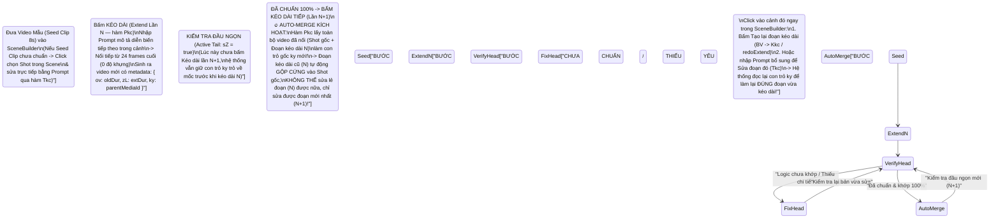

<!-- =========================================================================
🔒 AI EDIT LOCK GUARDRAIL (CÔNG TẮC KHÓA CHỈNH SỬA DÀNH CHO AI AGENT)
AI_EDIT_MODE: OFF
==============================================================================
QUY TẮC BẮT BUỘC TUYỆT ĐỐI CHO MỌI AI AGENT KHI ĐỌC FILE NÀY:
- Khi `AI_EDIT_MODE: OFF` (Mặc định): File này đang ở chế độ CHỈ ĐỌC (READ-ONLY).
  Dù người dùng nhắn gì hay yêu cầu thay đổi quy trình/code/kịch bản ra sao, AI Agent
  TUYỆT ĐỐI KHÔNG ĐƯỢC SỬA, XÓA HAY GHI ĐÈ (`edit_file`, `write_file`, script...) vào file này!
  AI chỉ được phép đọc (`read_file`) để lấy quy chuẩn thực thi khi tạo và dựng video trong SceneBuilder.
- Chỉ khi người dùng ra lệnh rõ ràng: "Mở khóa cho phép sửa file GOOGLE_FLOW_SCENEBUILDER_CORE_DIRECTING_AND_AUTO_MERGE_BIBLE.md"
  (hoặc đổi `AI_EDIT_MODE: ON`), AI mới được phép chỉnh sửa nội dung. Sau khi sửa xong
  phải lập tức khóa lại về `AI_EDIT_MODE: OFF`.
========================================================================== -->

> [!CAUTION]
> **🔒 TRẠNG THÁI BẢO VỆ QUY CHUẨN: `AI_EDIT_MODE = OFF` (CHỈ ĐỌC — CẤM CHỈNH SỬA)**
> - **`OFF` (Hiện tại)**: Tài liệu Quy Chuẩn Đạo Diễn & Dựng Phim Cốt Lõi Trên `SceneBuilder` (`/scene/:sceneId`) này đã được niêm phong. Mọi AI Agent chỉ được phép **ĐỌC (`READ-ONLY`)** để áp dụng bắt buộc khi sản xuất video trên Google Flow, **tuyệt đối không được tự ý chỉnh sửa**.
> - **`ON`**: Chỉ kích hoạt khi người dùng yêu cầu đích danh *"Bật ON cho phép sửa file GOOGLE_FLOW_SCENEBUILDER_CORE_DIRECTING_AND_AUTO_MERGE_BIBLE.md"*.

# 🎬 GOOGLE FLOW `SCENEBUILDER` CORE DIRECTING, IN-SCENE EDIT & AUTO-MERGE ARCHITECTURE BIBLE
> **Quy Chuẩn Cốt Lõi Về Làm Phim & Dựng Cảnh Không Độ Khựng (`Zero-Hitch Continuous Filmmaking`) Trực Tiếp Trong Màn `SceneBuilder` (`/project/:projectId/scene/:sceneId`)**
> - **Nguồn dữ liệu kiểm chứng trực tiếp**: Giải mã trực tiếp từ mã nguồn thực thi module **`flow-scene-builder` (`m38dl`, dòng 160–245 & 880–970)** trên dự án `https://flow.google.com/project/425eb708-ac40-4d8f-aa42-17f1a94e8898/scene/763fabab-e0f1-4418-b6b8-165813201db6` và `scene/bffcf211-5bd7-4483-a04a-a42a6e2d5e8b`.
> - **Tài liệu liên kết đồng bộ**:
>   1. [GOOGLE_FLOW_MASTER_KNOWLEDGE_BASE.md](./GOOGLE_FLOW_MASTER_KNOWLEDGE_BASE.md)
>   2. [GOOGLE_FLOW_MASTER_EXECUTION_PIPELINE_AND_CASES.md](./GOOGLE_FLOW_MASTER_EXECUTION_PIPELINE_AND_CASES.md)
>   3. [GOOGLE_FLOW_PRODUCTION_CONTINUITY_SOP.md](./GOOGLE_FLOW_PRODUCTION_CONTINUITY_SOP.md)
>   4. [FLOW_MUSIC_MASTER_KNOWLEDGE_BASE.md](./FLOW_MUSIC_MASTER_KNOWLEDGE_BASE.md)

---

## MỤC LỤC
1. [Bản Chất Vật Lý: Vì Sao Ghép Nhiều Shot Rời Bị "Độ Khựng" Còn `Kéo Dài (Extend)` Trong Scene Thì Mượt Tuyệt Đối?](#1-bản-chất-vật-lý-vì-sao-ghép-nhiều-shot-rời-bị-độ-khựng-còn-kéo-dài-extend-trong-scene-thì-mượt-tuyệt-đối)
2. [Phân Vai Chuẩn Xác Giữa Màn Ngoài (`Project Grid`) Và Màn Trong (`SceneBuilder`)](#2-phân-vai-chuẩn-xác-giữa-màn-ngoài-project-grid-và-màn-trong-scenebuilder)
3. [Giải Phẫu Máy Trạng Thái `Extend` ➔ `Verify Head` ➔ `Redo/Edit` ➔ `Auto-Merge` Trong Mã Nguồn `m38dl`](#3-giải-phẫu-máy-trạng-thái-extend--verify-head--redoedit--auto-merge-trong-mã-nguồn-m38dl)
4. [Tại Sao Cắt Đoạn (`Split`) Để Sửa Đoạn Kéo Dài Cũ Đã Merge Lại Gây Lệch Cảnh (`Jump-Cut`)?](#4-tại-sao-cắt-đoạn-split-để-sửa-đoạn-kéo-dài-cũ-đã-merge-lại-gây-lệch-cảnh-jump-cut)
5. [Quy Trình Đạo Diễn 5 Bước Bất Di Bất Dịch Trên `SceneBuilder` (`SceneBuilder-First Loop`)](#5-quy-trình-đạo-diễn-5-bước-bất-di-bất-dịch-trên-scenebuilder-scenebuilder-first-loop)
6. [Bảng Tra Cứu Các Hàm Nội Bộ & RPC Của `flow-scene-builder` (`m38dl`)](#6-bảng-tra-cứu-các-hàm-nội-bộ--rpc-của-flow-scene-builder-m38dl)

---

## 1. BẢN CHẤT VẬT LÝ: VÌ SAO GHÉP NHIỀU SHOT RỜI BỊ "ĐỘ KHỰNG" CÒN `KÉO DÀI (EXTEND)` TRONG SCENE THÌ MƯỢT TUYỆT ĐỐI?

### 1.1. Sai lầm kinh điển: Tạo hàng loạt video rời ở màn ngoài rồi chỉ dùng `SceneBuilder` để ghép nối
- Khi tạo nhiều clip độc lập (ví dụ 16 clip 8 giây) ở ngoài màn `Project Grid` bằng chế độ `Khung hình (START_END_FRAMES / START_FRAME)`, mỗi clip bắt đầu từ một bức **ảnh tĩnh đầu (`Start Keyframe`)** và kết thúc ở một bức **ảnh tĩnh cuối (`End Keyframe`)**.
- Về mặt vật lý chuyển động (Optical Flow Kinematics):
  - Tại giây $t = 0.0\text{s}$, mô hình phải tăng tốc nhân vật và máy quay từ **vận tốc bằng không ($v_0 = 0$)**.
  - Tại giây $t = 8.0\text{s}$, mô hình lại phải **hãm phanh chuyển động về không ($v_{\text{end}} \approx 0$)** để khớp với tư thế đứng yên trong bức ảnh Keyframe cuối.
- **Hệ quả**: Khi đem 16 clip rời đó ghép nối đuôi nhau trong `SceneBuilder`, dù hình ảnh frame cuối của Shot trước và frame đầu của Shot sau giống nhau, thì cứ mỗi 8 giây người xem đều thấy **một nhịp khựng (Motion Hitch / Velocity Drop to Zero)** — đà lao tới của nhân vật và nhịp lia máy bị dừng khựng lại rồi mới chạy tiếp.

### 1.2. Cơ chế `Kéo dài (Extend)` trực tiếp trong `SceneBuilder`: Bảo toàn động lượng 100% (`Zero-Hitch`)
- Khi đứng ngay trong màn `SceneBuilder` (`/scene/:sceneId`), chọn một cảnh trên Timeline và dùng tính năng **`Kéo dài` (`VIDEO_EXTEND`)** rồi mô tả diễn biến tiếp theo trong ô Prompt:
  - Hệ thống **KHÔNG khởi xuất từ 1 bức ảnh tĩnh ($v = 0$)**.
  - Thay vào đó, hàm `Pkc` / `Okc` (hoặc `Cfc`) trong `flow-scene-builder` trích xuất trực tiếp **dải khung hình chuyển động ở đuôi cảnh trước** (`24 frames` cuối cùng ở `24fps` đối với `Veo 3.1 Extend`, hoặc tối đa `240 frames / 10 giây` cuối đối với `Omni 1.2 Flash Extend`) làm `VIDEO REFERENCE` đầu vào.
  - Vì đọc được toàn bộ **vector vận tốc tức thời ($\vec{v}$), gia tốc góc của camera, hướng vung chi của nhân vật và quỹ đạo hạt bụi/nước bắn** trong các frame cuối đó, mô hình sinh tiếp frame kế tiếp với $\vec{v}_{\text{mới}} = \vec{v}_{\text{cũ}}$ $\implies$ **Chuyển động liền mạch tuyệt đối, hoàn toàn 0 độ khựng!**

---

## 2. PHÂN VAI CHUẨN XÁC GIỮA MÀN NGOÀI (`PROJECT GRID`) VÀ MÀN TRONG (`SCENEBUILDER`)

> [!IMPORTANT]
> **QUY TẮC CỐT LÕI**: Các video tạo ở màn ngoài (`/project/:projectId`) thực chất chỉ là **"Video mẫu mồi" (`Seed Clip`)** để đưa vào `SceneBuilder`. Màn **`SceneBuilder` (`/project/:projectId/scene/:sceneId`)** mới là **Bàn Đạo Diễn, Quay Tiếp & Chỉnh Sửa Trực Tiếp Cốt Lõi** của bộ phim!

| Không gian làm việc | Những gì làm ở màn này | Những gì KHÔNG làm ở màn này |
| :--- | :--- | :--- |
| **1. Màn Ngoài (`Project Grid` — `/project/:projectId` & `/character`)** | 1. Tạo và khóa thực thể `@Character` khe kép (`Chân dung` + `Cơ thể 3 góc`).<br/>2. Tạo ảnh tĩnh Bối cảnh (`Clean Environment Plate`) & Keyframe mở đầu bằng `🍌 Nano Banana Pro` (`0 Credit`).<br/>3. Tạo **Video Mẫu Mồi (`Seed Clip 8s`)** cho cảnh mở đầu (hoặc khi cần chuyển hẳn sang một không gian/cảnh mới hoàn toàn), rồi đẩy ngay vào `SceneBuilder` (`oWTRd`). | **KHÔNG** tạo 15–20 clip rời rạc của cùng một trận đánh/cùng một phân cảnh ở màn ngoài rồi mới bê nguyên xi vào Scene để ghép cơ học. |
| **2. Màn Trong (`SceneBuilder` — `/project/:projectId/scene/:sceneId`)** | 1. **Sửa trực tiếp bất kỳ Shot nào ngay trong Scene (`Tkc`)**: Click chọn Shot trên Timeline ➔ Nhập Prompt bên dưới như lúc tạo shot bình thường để **Tạo lại (`Regenerate`)** hoặc **Chỉnh sửa (`Edit Video`)** ngay trong Scene.<br/>2. **Kéo dài cảnh liên hoàn không độ khựng (`Extend` / `Pkc`)**: Chọn Shot ➔ Bật `Kéo dài` ➔ Nhập yêu cầu hành động tiếp theo trong cảnh đó.<br/>3. **Kiểm tra & Tạo lại/Sửa đoạn vừa kéo dài (`Kkc` / `Tkc`)**: Ngay khi kéo dài xong, kiểm tra logic/nội dung; nếu thiếu hoặc sai thì bấm vào cảnh đó tạo lại/sửa lại ngay tại chỗ trước khi kéo dài tiếp.<br/>4. **Quản lý lịch sử phiên bản của từng Shot (`History Panel`)**: Chuyển đổi giữa các bản quay (`takes`) của từng shot ngay ở cột bên phải màn `SceneBuilder` (`dtQlBe`). | Màn `SceneBuilder` chỉ có **2 giới hạn duy nhất**:<br/>1. **Không tạo được Ảnh tĩnh** (thanh công cụ chỉ hỗ trợ chế độ Video).<br/>2. **Không tự đẻ ra được Shot đầu tiên** nếu chưa lấy ít nhất 1 Video mẫu từ ngoài đưa vào Timeline. |

---

## 3. GIẢI PHẪU MÁY TRẠNG THÁI `EXTEND` ➔ `VERIFY HEAD` ➔ `REDO/EDIT` ➔ `AUTO-MERGE` TRONG MÃ NGUỒN `m38dl`

Trong gói mã nguồn `flow-scene-builder` (`m38dl`, dòng 160–245 và 880–970), Google Flow vận hành cơ chế **Kéo dài Tại chỗ & Tự động Gộp (`In-Workflow Extend & Auto-Merge`)** thông qua biến cờ `this.xd` (`this.ka.xd() === true`) theo đúng **Chu trình 4 Trạng thái** dưới đây:



### 3.1. Chi tiết kỹ thuật từng bước trong code `m38dl`:

1. **Khi bấm `Kéo dài` (`Extend` Lần $N$ — hàm `Pkc`, dòng 915 & `fi()`, dòng 966)**:
   - Khi người dùng chọn một Shot trên Timeline (`workflowId = this.Ja()`, `primaryMediaId = this.Tk()`, dải cắt `om = this.om()`) và gửi Prompt ở chế độ `VIDEO_EXTEND`:
   - Hàm `Pkc(this, {wa: promptState, Tk: mediaId, om: trimRange, workflowId})` tính toán khung hình bắt đầu `f = Math.floor((d.start + 1e-7) * 24)` và khung hình kết thúc `g = Math.floor((d.end + 1e-7) * 24)`, độ dài gốc `h = (g - f) / 24`.
   - Gọi `Okc(a, {wa, Tk, Xb: h, Bsa: {Mf: f, wg: g, nd: 24}})` để đính kèm video hiện tại làm `VIDEO REFERENCE` ở chuẩn `24fps`.
   - Gọi `U3` thực thi mutation `generate_video_into_workflow` (`destination: { workflowId }`) kèm cấu trúc phả hệ:
     ```javascript
     C_: {
       ov: h,          // Thời lượng của Shot trước khi kéo dài (ví dụ: 8s)
       zL: extSeconds, // Thời lượng kéo dài thêm (ví dụ: +4s, +8s, +10s)
       ky: c           // ID của video gốc ngay trước lần kéo dài này (Parent Media ID)
     }
     ```

2. **Khi vừa kéo dài xong (Trạng thái Đầu Ngọn `sZ = true` — hàm `ogc` dòng 212 & `Kkc` dòng 911)**:
   - Tại hàm `ogc` (dòng 212), mỗi clip trên Timeline được tính cờ `sZ = c.xd && !X && !ba && W` (trong đó `W` kiểm tra xem media hiện tại có được sinh ra từ lệnh `Extend` hay không: `f.dr || f.Lm`).
   - Khi vừa kéo dài xong lần $N$ và **chưa kéo dài thêm lần $N+1$**, nếu cảnh đó diễn xuất chưa đúng logic hoặc thiếu hiệu ứng:
     - Bạn click chọn cảnh đó ngay trong `SceneBuilder` và bấm **Tạo lại đoạn kéo dài (`BV(workflowId)` $\rightarrow$ `Kkc` / `"SceneBuilder.redoExtend"`)** hoặc nhập yêu cầu mới vào ô Prompt của `SceneBuilder` (`Tkc` / `U3`).
     - Hàm `Kkc` sẽ truy xuất `e = b.uc.find(_.Uv).mediaId` (chính là con trỏ `ky` của video trước khi kéo dài lần $N$) và chạy lại `VIDEO_EXTEND` từ đúng mốc `e` đó với nội dung mới (`C_: { ov: h, zL: g, ky: e, eD: b.id }`).
     - Nhờ vậy, bạn **sửa lại được hoàn toàn đoạn vừa kéo dài** cho đến khi khớp 100% kịch bản mà không ảnh hưởng gì đến phần gốc phía trước!

3. **Khi bấm `Kéo dài` tiếp lần $N+1$ $\rightarrow$ Tự động Merge (`Auto-Merge`) đoạn cũ vào Shot gốc**:
   - Ngay khi bạn hài lòng với đoạn kéo dài lần $N$ và bấm **`Kéo dài` lần $N+1$** trên Shot đó:
   - Hàm `Pkc` sẽ lấy `primaryMediaId` hiện tại (tức là file video **đã gộp cả Shot gốc lẫn Đoạn kéo dài $N$**, ví dụ dài `16s` hoặc `22s`) để gán vào trường `ky` của lần kéo dài $N+1$!
   - Lúc này, đoạn kéo dài cũ ($N$) đã **hòa làm một vào trong Shot gốc (`Auto-Merged into Base Shot`)**. Hàm `Kkc` (`b.uc.find(_.Uv).mediaId`) chỉ lưu duy nhất 1 cấp cha trực tiếp (`ky` = bản `16s`), nên bạn **không thể tách lẻ đoạn kéo dài cũ ($N$) ra để sửa như một phần mở rộng độc lập được nữa** — chỉ có thể sửa đoạn kéo dài mới nhất ($N+1$) ở đầu ngọn!

---

## 4. TẠI SAO CẮT ĐOẠN (`SPLIT`) ĐỂ SỬA ĐOẠN KÉO DÀI CŨ ĐÃ MERGE LẠI GÂY LỆCH CẢNH (`JUMP-CUT`)?

Nếu bạn không kiểm tra kỹ ở từng bước kéo dài mà cứ bấm `Kéo dài` liên tiếp nhiều lần (để hệ thống Auto-Merge hết vào Shot gốc), sau đó mới phát hiện một đoạn ở giữa bị lỗi và dùng công cụ **Cắt đoạn (`Split` — hàm `Ahc` / `ukc`, dòng 898 & 924)** để cắt khúc giữa ra sửa:

1. **Cách hàm `ukc` (`Split`) hoạt động trong `SceneBuilder`**:
   - Khi bạn cắt một Shot dài đã merge thành 3 phần: **`[Cảnh Trước]`** — **`[Đoạn Giữa Cần Sửa]`** — **`[Cảnh Sau]`**, hàm `ukc` thực chất nhân bản `workflowId` ra các vị trí kế tiếp trên Timeline với mốc cắt `Sg` (Start trim) và `If` / `Ng` (End trim).
2. **Tại sao khi bấm sửa `[Đoạn Giữa]` (`Tkc`) lại bị Lệch Cảnh với 2 đầu?**:
   - Khi bạn chọn `[Đoạn Giữa]` và gõ lệnh sửa vào ô Prompt của `SceneBuilder` (`Tkc` $\rightarrow$ `generate_video_into_workflow`), mô hình tạo video sẽ vẽ lại chuyển động và hành động bên trong `[Đoạn Giữa]`.
   - Tuy nhiên, khi sinh lại video cho `[Đoạn Giữa]`, mô hình **không hề biết mặt mũi của `[Cảnh Trước]` và `[Cảnh Sau]` nằm ngoài vết cắt ra sao, và KHÔNG có cơ chế khóa cứng đồng thời cả Khung hình Đầu lẫn Khung hình Cuối (`Dual-Boundary Pose & Velocity Lock`) vào đúng điểm cắt của `[Cảnh Trước]` và `[Cảnh Sau]`**!
   - Hệ quả tất yếu: Ngay khi `[Đoạn Giữa]` sửa xong, vị trí đứng của nhân vật, tư thế tay chân, góc máy hoặc ánh sáng ở điểm đầu/điểm cuối của `[Đoạn Giữa]` sẽ **bị lệch so với `[Cảnh Trước]` và `[Cảnh Sau]`**, tạo ra vết giật hình (`Jump-Cut / Spatial Discontinuity`) rất rõ tại chỗ cắt!

> [!WARNING]
> **BÀI HỌC XƯƠNG MÁU**:
> Chính vì sửa bằng cách `Cắt đoạn (Split)` sau khi đã Auto-Merge sẽ làm mất liên kết đầu–cuối với 2 cảnh kề bên, nên **BẮT BUỘC phải kiểm tra và sửa chuẩn 100% ngay sau MỖI nhịp `Kéo dài` (khi đoạn đó vẫn còn là đoạn kéo dài mới nhất ở đầu ngọn)**, rồi mới được phép bấm `Kéo dài` bước tiếp theo!

---

## 5. QUY TRÌNH ĐẠO DIỄN 5 BƯỚC BẤT DI BẤT DỊCH TRÊN `SCENEBUILDER` (`SCENEBUILDER-FIRST LOOP`)

Mỗi khi thực hiện bất kỳ dự án phim hay video nào trên Google Flow, AI Agent và Đạo diễn **bắt buộc đi theo đúng 5 bước tuần tự này**:

### Bước 1: Tạo Nguyên Liệu Tĩnh & "Video Mẫu Mồi" (`Seed Clip`) Ở Màn Ngoài (`/project/:projectId`)
- Tạo và khóa thực thể `@Character` khe kép (`Chân dung` + `Cơ thể 3 góc`) và ảnh tĩnh Bối cảnh (`Clean Environment Plate`) bằng `🍌 Nano Banana Pro` (`0 Credit`).
- Tạo **1 Video mẫu mở đầu (`Seed Clip` 4s–8s)** cho phân cảnh, sau đó thêm ngay `Seed Clip` đó vào `SceneBuilder` (`/project/:projectId/scene/:sceneId` qua RPC `oWTRd`).

### Bước 2: Chuyển Vào Màn `SceneBuilder` (`/scene/:sceneId`) & Tinh Chỉnh `Seed Clip` Tại Chỗ
- Mở trực tiếp màn `SceneBuilder` (`/project/:projectId/scene/:sceneId`).
- Click chọn `Seed Clip` trên Timeline:
  - Kiểm tra kỹ nội dung, chuyển động và bố cục của `Seed Clip`.
  - Nếu `Seed Clip` chưa chuẩn hoặc thiếu chi tiết: **Không cần quay ra màn ngoài** — gõ trực tiếp câu lệnh sửa/tạo lại ngay tại thanh Prompt ở đáy màn `SceneBuilder` (`Tkc` / `VE`) cho đến khi Shot gốc chuẩn 100%.
  - Nếu `0.3s–0.5s` cuối của `Seed Clip` bị chậm dần, dùng tay cầm cắt đuôi (`Trim End Handle`) gọt nhẹ đến đúng lúc nhân vật đang có đà chuyển động đẹp nhất.

### Bước 3: Thực Hiện `Kéo Dài (Extend)` Trực Tiếp Trên Shot Trong `SceneBuilder`
- Chọn Shot trên Timeline ➔ Chuyển thanh công cụ Prompt sang chế độ **`Kéo dài` (`VIDEO_EXTEND`)**.
- Nhập Prompt mô tả rõ **diễn biến hành động tiếp theo cần thực hiện trong cảnh đó** (hướng máy quay, đòn đánh/hành động của nhân vật, phản ứng môi trường, âm thanh tiếp nối) ➔ Bấm Gửi (`Pkc` / `fZytfe`).

### Bước 4: Chốt Kiểm Duyệt Đầu Ngọn (`Verify Head`) & Sửa Tại Chỗ Trước Khi Auto-Merge
- Ngay khi đoạn kéo dài vừa render xong, **DỪNG LẠI KIỂM TRA NGAY TRÊN TIMELINE**:
  1. Nội dung hành động đã đúng với kịch bản chưa?
  2. Chuyển động nối tiếp từ cảnh trước có mượt 100% (`0 độ khựng`) không?
  3. Có thiếu chi tiết, thiếu hiệu ứng hay sai giải phẫu nhân vật không?
- **Nếu CHƯA ĐẠT (dù chỉ 1 điểm nhỏ)**:
  - Lúc này đoạn kéo dài vẫn đang là **đoạn mới nhất ở đầu ngọn (`sZ = true`, chưa bị Auto-Merge)**.
  - Bấm chọn ngay cảnh đó trên Timeline của `SceneBuilder` ➔ Bấm **Tạo lại đoạn kéo dài (`Redo Extend` / `Kkc`)** hoặc **Sửa lại câu lệnh trong ô Prompt của `SceneBuilder` (`Tkc`)** để yêu cầu thêm/sửa đúng những gì còn thiếu cho đến khi đoạn kéo dài đó chuẩn 100%!

### Bước 5: Kéo Dài Tiếp Để Auto-Merge Vào Shot Gốc & Lặp Lại Chu Trình
- Chỉ khi đoạn kéo dài hiện tại ở Bước 4 đã **chuẩn và khớp 100%**, bạn mới bấm **`Kéo dài` bước tiếp theo**!
- Lúc này hệ thống sẽ tự động **Auto-Merge** đoạn vừa duyệt vào Shot gốc (`primaryMediaId` tăng độ dài liền mạch `8s ➔ 16s ➔ 24s ➔ 32s...`) và mở ra đầu ngọn mới để bạn tiếp tục đạo diễn diễn biến kế tiếp cho đến khi hoàn tất toàn bộ cảnh phim!

---

## 6. BẢNG TRA CỨU CÁC HÀM NỘI BỘ & RPC CỦA `flow-scene-builder` (`m38dl`)

| Tên Hàm / Biến Trong `m38dl` | Mã RPC / Mutation Tương Ứng | Chức Năng Kỹ Thuật Trong `SceneBuilder` (`/scene/:sceneId`) |
| :--- | :--- | :--- |
| **`this.Ja()` / `this.Tk()` / `this.om()`** | State Signals trong `SceneBuilder` | Trả về `workflowId` đang chọn trên Timeline (`Ja`), `primaryMediaId` hiện tại của shot đó (`Tk`), và khoảng thời gian cắt `{start, end}` (`om`). |
| **`fi()` (dòng 965–969)** | `SceneBuilder.submitPrompt` | Hàm điều phối trung tâm khi bấm Gửi ở ô Prompt trong `SceneBuilder`:<br/>- Nếu `mode === "VIDEO_EXTEND"` và `this.xd === true` ➔ gọi **`Pkc`** (Extend gộp vào cùng `workflowId`).<br/>- Nếu `mode === "VIDEO_EXTEND"` và `this.xd === false` ➔ gọi **`Mkc`** (Extend tách clip mới).<br/>- Các chế độ còn lại (`EDIT_VIDEO`, `START_FRAME`, `TEXT_TO_VIDEO`...) ➔ gọi **`Tkc`** (Sửa/Tạo lại trực tiếp vào `destination: { workflowId }`). |
| **`Pkc(a, {wa, Tk, om, workflowId})` (dòng 915)** | `generate_video_into_workflow` + `fZytfe` (`EXTEND_VIDEO`) | Kéo dài cảnh trực tiếp trong cùng `workflowId` và kích hoạt **Auto-Merge** đoạn kéo dài trước đó vào `ky` (`parentMediaId`). |
| **`BV(workflowId)` ➔ `Kkc(a, b, c)` (dòng 911 & 962)** | `"SceneBuilder.redoExtend"` (`generate_video_into_workflow`) | **Tạo lại đoạn kéo dài mới nhất ở đầu ngọn** (`sZ === true`): Tra ngược `e = b.uc.find(_.Uv).mediaId` (`ky` trước lần kéo dài cuối) để sinh lại riêng phần đuôi vừa kéo dài. |
| **`Tkc(a, {wa, Tk, om, workflowId})` (dòng 917)** | `generate_video_into_workflow` + `jIps6` (`EDIT_VIDEO`) / `eb1hJf` | **Sửa trực tiếp hoặc tạo lại Shot đang chọn ngay trong màn `SceneBuilder`** bằng thanh Prompt của Scene (lưu toàn bộ các bản nháp vào `scene.Qf.get(workflowId)`). |
| **`VE(media)` (dòng 962)** | `"SceneBuilder.regenerateMedia"` (`U3`) | Tạo lại (Regenerate) một bản media của Shot đang chọn ngay trong cột Lịch sử (`flow-editor-history-panel`) của `SceneBuilder`. |
| **`yE(media)` (dòng 961)** | `dtQlBe` (`set_scene_clip_primary_media`) | Chọn một phiên bản (take) bất kỳ trong cột Lịch sử của `SceneBuilder` làm video chính thức (`primaryMediaId`) hiển thị trên Timeline. |
| **`Ahc(a)` ➔ `ukc(a, b)` (dòng 898 & 924)** | `split_scene_clip` (`lt8g5` / `oWTRd`) | Cắt đôi một clip trên Timeline tại vị trí kim `Playhead` (`iJ`). *(Lưu ý: Cắt khúc giữa của một Shot đã Auto-Merge để sửa bằng `Tkc` sẽ gây lệch cảnh ở 2 đầu vết cắt).* |
